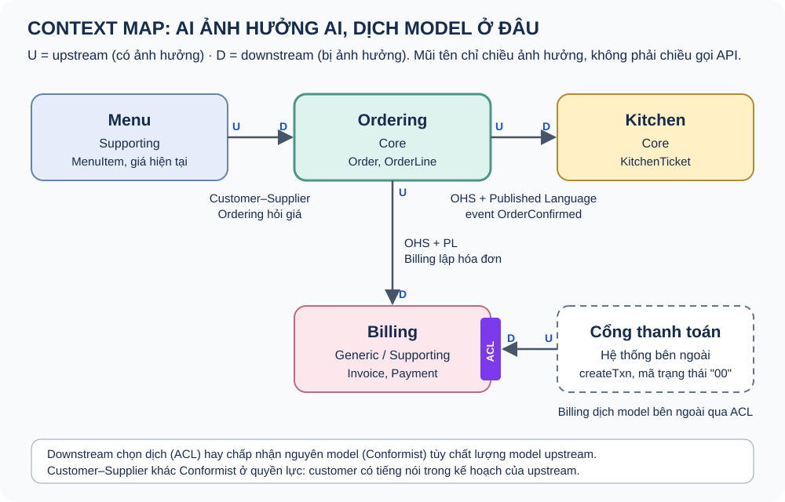
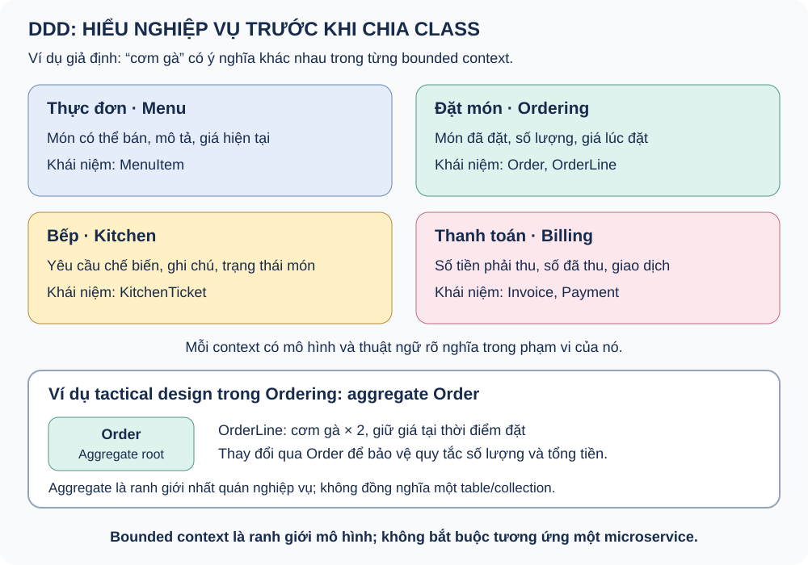
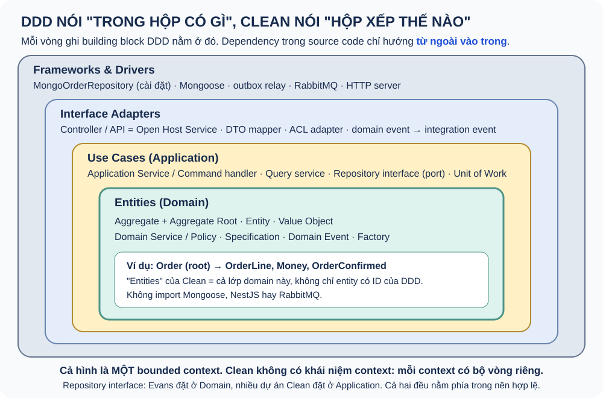

# Domain-Driven Design — sổ tay học chặt chẽ và so sánh với Clean Architecture

Sổ tay riêng về DDD. Mục tiêu là hiểu **định nghĩa chính xác** của từng khái niệm (theo Evans, Vernon, Fowler), biết **ranh giới** giữa chúng, và trả lời được câu hỏi "DDD khác Clean Architecture ở đâu" mà không lẫn lộn.

Cấu trúc gồm 4 phần:

- **Phần I, Strategic Design (bài 0–4):** ngôn ngữ, ranh giới và quan hệ giữa các phần của nghiệp vụ.
- **Phần II, Tactical Design (bài 5–9):** hiện thực mô hình bên trong một ranh giới. Có code TypeScript minh họa.
- **Phần III, Thực hành (bài 10–12):** khám phá domain, chọn kiểu mô hình, và làm trọn ví dụ nhà hàng.
- **Phần IV, So sánh và áp dụng (bài 13–16):** DDD và Clean Architecture; DDD với CQRS, Event Sourcing, Microservices; Hexagonal/Onion; DDD ở w-identity.

Ví dụ xuyên suốt là **nhà hàng** (Thực đơn, Đặt món, Bếp, Thanh toán). Đây là ví dụ tự dựng để học, code TypeScript trong các bài 5–12 **chưa chạy thử** và không phải code của repo. Riêng bài 16 phân tích code w-identity thật và chỉ khẳng định những gì code có.

Học theo thứ tự. Mỗi ngày đọc hai bài, tự nói câu trả lời trong 60–90 giây rồi luyện thẻ câu hỏi. Trạng thái 📖 là tài liệu lý thuyết, không khẳng định bạn đã học thuộc.

## Bảng tiến độ

| # | Chủ đề | Bước PLAN | Trạng thái |
|---|---|---|---|
| 0 | DDD trong 60 giây: là gì và không là gì | Strategic | 📖 |
| 1 | Domain, Model và Ubiquitous Language | Strategic | 📖 |
| 2 | Bounded Context | Strategic | 📖 |
| 3 | Subdomain, Core Domain và Distillation | Strategic | 📖 |
| 4 | Context Map: 9 pattern quan hệ | Strategic | 📖 |
| 5 | Entity và Value Object | Tactical | 📖 |
| 6 | Aggregate: ranh giới nhất quán | Tactical | 📖 |
| 7 | Domain Service, Application Service, Policy, Specification | Tactical | 📖 |
| 8 | Domain Event | Tactical | 📖 |
| 9 | Repository, Factory và Unit of Work | Tactical | 📖 |
| 10 | Event Storming và Domain Storytelling | Thực hành | 📖 |
| 11 | Transaction Script, Anemic Model và Rich Domain Model | Thực hành | 📖 |
| 12 | Ví dụ nhà hàng làm trọn vẹn | Thực hành | 📖 |
| 13 | DDD và Clean Architecture | So sánh | 📖 |
| 14 | DDD với CQRS, Event Sourcing và Microservices | So sánh | 📖 |
| 15 | Hexagonal, Onion và Clean nhìn từ DDD | So sánh | 📖 |
| 16 | DDD ở w-identity: User, Role và UserRole | Áp dụng | 📖 |

## 0. DDD trong 60 giây: là gì và không là gì

**Định nghĩa.** Domain-Driven Design là một cách tiếp cận phát triển phần mềm cho **nghiệp vụ phức tạp**. Thuật ngữ đến từ cuốn sách của Eric Evans năm 2003, *Domain-Driven Design: Tackling Complexity in the Heart of Software*. DDD dựa trên ba ý:

1. Tập trung vào **core domain**, là phần nghiệp vụ tạo ra giá trị khác biệt.
2. Khám phá mô hình qua **hợp tác sáng tạo** giữa developer và chuyên gia nghiệp vụ (domain expert).
3. Dùng một **ngôn ngữ chung** (Ubiquitous Language) **bên trong một ranh giới rõ ràng** (Bounded Context).

Ba ý này là phần tóm tắt mà Evans đặt ở đầu tài liệu *DDD Reference* (2015).

### DDD có hai nửa

| Nửa | Câu hỏi | Công cụ chính |
|---|---|---|
| **Strategic Design** | Nghiệp vụ gồm những phần nào? Ngôn ngữ và ranh giới nằm ở đâu? Các phần quan hệ với nhau ra sao? Đầu tư vào đâu? | Ubiquitous Language, Bounded Context, Subdomain, Context Map, Distillation |
| **Tactical Design** | Bên trong một bounded context, thể hiện mô hình bằng code như thế nào? | Entity, Value Object, Aggregate, Domain Service, Domain Event, Repository, Factory, Module |

Strategic đi trước. Nếu chọn sai ranh giới, pattern tactical đẹp đến đâu cũng chỉ mô hình hóa sai bài toán. Nhiều người cho rằng nửa strategic mới là phần giá trị nhất của DDD, còn tactical là bộ công cụ có thể thay đổi theo ngôn ngữ lập trình.

### DDD không phải là

| Hiểu sai | Vì sao sai |
|---|---|
| Một kiến trúc hay cách chia folder `domain/application/infrastructure` | DDD không quy định cấu trúc thư mục. Clean Architecture mới là cách sắp xếp dependency (xem bài 13) |
| "Dùng Entity và Repository" | Đó chỉ là building block. Thiếu ngôn ngữ chung và ranh giới thì vẫn chưa phải DDD |
| Bắt buộc microservices, CQRS hoặc Event Sourcing | Đây là các quyết định độc lập (bài 14). Bounded context có thể nằm trong một monolith |
| Áp dụng cho mọi dự án | DDD tốn công. Với CRUD đơn giản hoặc subdomain generic thì Transaction Script thường hợp lý hơn (bài 11) |
| Một framework hoặc thư viện | DDD là cách tư duy và một bộ pattern, không có "cài đặt chuẩn" |

**Bẫy phỏng vấn:** Định nghĩa DDD bằng cấu trúc thư mục, hoặc bắt đầu câu trả lời bằng Entity/Repository mà không nhắc Ubiquitous Language và Bounded Context.

**Tự kiểm tra:** Nêu ba ý cốt lõi của DDD. Vì sao strategic đi trước tactical? Kể hai điều DDD *không* bắt buộc.

## 1. Domain, Model và Ubiquitous Language

### Định nghĩa

- **Domain:** lĩnh vực hoạt động hoặc kiến thức mà phần mềm phục vụ, ví dụ vận hành nhà hàng.
- **Domain model:** một **hệ thống trừu tượng có chọn lọc** mô tả những khía cạnh của domain cần thiết để giải bài toán. Model không phải bản sao thực tế. Một model tốt là model *hữu ích* cho bài toán, không phải model *đầy đủ nhất*. Model có thể thể hiện bằng code, sơ đồ hoặc lời nói, nhưng trong DDD code phải phản ánh model (Evans gọi là **Model-Driven Design**).
- **Domain expert:** người hiểu sâu nghiệp vụ, ví dụ bếp trưởng hoặc quản lý ca. Không nhất thiết là người dùng cuối.
- **Knowledge crunching:** quá trình developer và domain expert cùng chắt lọc kiến thức. Họ đặt câu hỏi, thử mô hình, thấy sai thì sửa. Kết quả không chỉ là tài liệu mà là model trong code.

### Ubiquitous Language

**Ubiquitous Language** là ngôn ngữ được xây dựng quanh domain model và **dùng thống nhất ở mọi nơi trong một bounded context**: khi trao đổi với chuyên gia, trong tài liệu, trong tên class, method, event và trong test.

Ba tính chất cần nhớ:

1. **Gắn với một bounded context.** Không có một ngôn ngữ chung cho cả công ty. "Món" ở Bếp và "món" ở Thanh toán có thể mang nghĩa khác.
2. **Code là một phần của ngôn ngữ.** Nếu chuyên gia nói "xác nhận đơn" mà code viết `updateStatus(2)`, ngôn ngữ đang bị gãy. Nên viết `order.confirm()`.
3. **Thay đổi ngôn ngữ là thay đổi model.** Khi phát hiện một từ mới hoặc nghĩa mới, cần sửa cả code chứ không chỉ sửa tài liệu.

```ts
// Ngôn ngữ bị gãy: chỉ developer hiểu
order.status = 2;
order.items.push({ id, q: 1, p: 50000 });

// Ngôn ngữ chung: chuyên gia đọc tên method cũng hiểu
order.addLine(menuItemId, Quantity.of(1), Money.vnd(50_000));
order.confirm();
```

### Dấu hiệu ngôn ngữ đang có vấn đề

- Cần một "bảng dịch" giữa thuật ngữ nghiệp vụ và tên trong code.
- Một từ được dùng cho hai khái niệm khác nhau trong cùng một context. Đây là dấu hiệu cần tách context.
- Hai từ khác nhau chỉ cùng một khái niệm, ví dụ "booking" và "reservation". Cần thống nhất chọn một từ.
- Tên kỹ thuật chiếm chỗ tên nghiệp vụ: `OrderManager`, `processData`, `handleItem`.

**Bẫy phỏng vấn:** Hiểu Ubiquitous Language là "dùng tiếng Anh thống nhất" hoặc "có glossary". Glossary chỉ là phụ. Cốt lõi là ngôn ngữ xuất hiện *trong code* và được dùng *khi trao đổi*.

**Tự kiểm tra:** Model khác thực tế ở đâu? Vì sao Ubiquitous Language gắn với bounded context chứ không phải với cả công ty? Cho một ví dụ tên code làm gãy ngôn ngữ.

## 2. Bounded Context

### Định nghĩa

**Bounded Context** là ranh giới (thường gắn với một subsystem hoặc một nhóm làm việc) mà bên trong đó **một model cụ thể được định nghĩa, áp dụng và có nghĩa nhất quán**. Ngoài ranh giới, cùng một từ có thể mang nghĩa khác và cần một model khác.

Lý do tồn tại: trong một hệ thống lớn, cố ép một model thống nhất cho mọi nơi sẽ tạo ra **mô hình khổng lồ, mâu thuẫn và không ai hiểu hết**. Evans viết rằng mô hình thống nhất toàn hệ thống "không khả thi và không đáng chi phí". Vì vậy cần chia ra nhiều model, mỗi model có ranh giới rõ.

### Ví dụ: "Khách hàng"

| Context | "Khách hàng" là gì | Thuộc tính quan trọng |
|---|---|---|
| Đặt bàn | Người giữ chỗ | Tên, số điện thoại, số người, giờ đến |
| Thanh toán | Người trả tiền | Phương thức thanh toán, mã số thuế cho hóa đơn |
| Khách hàng thân thiết | Thành viên | Hạng, điểm, lịch sử chi tiêu |

Ba model `Customer` riêng, nhỏ, đúng nghĩa trong context của mình, tốt hơn một class `Customer` có 40 trường dùng cho mọi nơi.

### Dấu hiệu nên tách context

- Cùng một từ nhưng chuyên gia ở hai bộ phận định nghĩa khác nhau.
- Một model có nhiều trường chỉ một nhóm dùng, nhóm khác bỏ qua.
- Thay đổi quy tắc của nhóm A thường xuyên làm vỡ chức năng của nhóm B.
- Hai nhóm phát triển có nhịp thay đổi khác hẳn nhau.

### Bounded Context không phải là

| Nhầm với | Khác biệt |
|---|---|
| **Subdomain** | Subdomain thuộc *không gian bài toán* (nghiệp vụ có phần nào). Bounded context thuộc *không gian giải pháp* (model được ranh giới ở đâu). Lý tưởng là khớp một-một, nhưng không bắt buộc (bài 3) |
| **Microservice** | Một bounded context *có thể* triển khai thành một microservice, nhưng cũng có thể là một module trong monolith. Một context cũng có thể gồm vài service. Bounded context là ranh giới **ngôn ngữ và model**, còn microservice là ranh giới **triển khai** |
| **Module/package** | Module là cách tổ chức code *bên trong* một context. Một context thường có nhiều module |
| **Team** | Nên để một team sở hữu một context (hoặc nhiều context), nhưng không nên để hai team cùng sửa một context mà không phối hợp chặt |

### Định luật Conway

Định luật Conway nói rằng cấu trúc hệ thống thường phản ánh cấu trúc giao tiếp của tổ chức. Vì vậy ranh giới context nên được quyết định cùng với cách chia team. Khi tách context mà không đổi cách giao tiếp giữa các team, ranh giới sẽ dần bị xóa.

**Bẫy phỏng vấn:** Trả lời "bounded context là microservice". Câu đúng hơn: "bounded context là ranh giới của một model. Một microservice thường bao một context, nhưng điều ngược lại không bắt buộc."

**Tự kiểm tra:** Định nghĩa bounded context trong một câu. Nêu hai dấu hiệu cần tách context. Bounded context khác subdomain và microservice thế nào?

## 3. Subdomain, Core Domain và Distillation

### Ba loại subdomain

**Subdomain** là một phần của domain tổng thể. Phân loại theo **giá trị chiến lược**, không theo kỹ thuật:

| Loại | Đặc điểm | Cách đầu tư | Ví dụ nhà hàng |
|---|---|---|---|
| **Core** | Tạo lợi thế cạnh tranh, phức tạp, thay đổi nhiều. Đây là lý do doanh nghiệp tồn tại | Tự xây, model sâu, đội giỏi nhất, DDD đầy đủ | Điều phối bếp tối ưu thời gian ra món (nếu đó là điểm khác biệt của chuỗi) |
| **Supporting** | Cần thiết, đặc thù cho doanh nghiệp, nhưng không tạo khác biệt | Tự xây nhưng đơn giản, có thể thuê ngoài | Quản lý thực đơn, ca làm |
| **Generic** | Bài toán chung đã có lời giải tốt | Mua hoặc dùng sản phẩm có sẵn | Đăng nhập (Keycloak), thanh toán thẻ, gửi email |

Cùng một nghiệp vụ có thể là core ở công ty này nhưng generic ở công ty khác. Thanh toán là generic với nhà hàng, nhưng là core với một công ty ví điện tử.

### Problem space và Solution space

| Không gian | Câu hỏi | Khái niệm |
|---|---|---|
| Problem space (bài toán) | Nghiệp vụ có những phần nào? | Domain, Subdomain |
| Solution space (giải pháp) | Phần mềm chia model thế nào? | Bounded Context, Context Map |

Quan hệ lý tưởng là một subdomain tương ứng một bounded context. Trong hệ thống cũ (legacy), một context có thể chứa nhiều subdomain trộn lẫn. Đây là tín hiệu nên tách dần.

### Distillation (chưng cất)

Phần IV trong sách của Evans nói về **distillation**: tách core domain ra khỏi phần còn lại để đội tập trung vào đó. Một số kỹ thuật:

- **Domain Vision Statement:** một trang ngắn mô tả core domain mang lại giá trị gì.
- **Highlighted Core:** đánh dấu rõ phần nào trong model là core.
- **Generic Subdomain:** tách phần generic ra, dùng sản phẩm có sẵn hoặc làm đơn giản.
- **Cohesive Mechanism:** tách các thuật toán phức tạp nhưng không thuộc nghiệp vụ (ví dụ thuật toán đồ thị) ra sau một interface.
- **Segregated Core:** tái cấu trúc để core nằm riêng, không bị trộn với code hỗ trợ.

**Core Domain Chart** (do cộng đồng DDD Crew phổ biến) đặt mỗi subdomain lên hai trục: *độ phức tạp nghiệp vụ* và *mức độ khác biệt*. Biểu đồ này giúp thảo luận nên đầu tư vào đâu.

**Bẫy phỏng vấn:** Áp tactical pattern đầy đủ cho subdomain generic. Ngược lại, mua sản phẩm cho đúng phần core rồi phải uốn nghiệp vụ theo sản phẩm.

**Tự kiểm tra:** Ba loại subdomain khác nhau ở tiêu chí nào? Cho ví dụ một nghiệp vụ là core ở công ty A nhưng generic ở công ty B. Subdomain khác bounded context thế nào?

## 4. Context Map: 9 pattern quan hệ

**Context Map** là tài liệu, thường kèm sơ đồ, mô tả **các bounded context hiện có và quan hệ giữa chúng**: ai phụ thuộc ai, trao đổi bằng hợp đồng nào, dịch model ở ranh giới ra sao. Context map vẽ **hiện trạng**, không vẽ mong muốn.



### Upstream và Downstream

- **Upstream (U):** bên cung cấp. Thay đổi của nó ảnh hưởng tới bên kia.
- **Downstream (D):** bên sử dụng. Bị ảnh hưởng bởi thay đổi của upstream.

Đây là chiều **ảnh hưởng**, không phải chiều dữ liệu chảy hay chiều gọi API. Kitchen nhận event từ Ordering, nên Kitchen là downstream.

### 9 pattern (theo DDD Reference của Evans)

| Pattern | Ý nghĩa | Khi nào dùng | Rủi ro |
|---|---|---|---|
| **Partnership** | Hai team cùng thành công hoặc cùng thất bại, phối hợp kế hoạch và phát hành | Hai context phụ thuộc lẫn nhau chặt, hai team giao tiếp tốt | Tốn công phối hợp; nếu một team rời đi thì quan hệ vỡ |
| **Shared Kernel** | Hai context dùng chung một phần model hoặc code nhỏ, mọi thay đổi phần chung cần hai bên đồng ý | Phần chung thật sự nhỏ và ổn định | Phần chung phình to dần thành "God model" |
| **Customer–Supplier** | Upstream (supplier) cung cấp, downstream (customer) có tiếng nói trong kế hoạch của upstream | Hai team khác nhau, upstream sẵn lòng phục vụ downstream | Upstream ưu tiên việc khác, downstream bị bỏ rơi |
| **Conformist** | Downstream chấp nhận nguyên model của upstream, không dịch | Upstream không quan tâm tới downstream, nhưng model của nó đủ tốt | Model của upstream "nhiễm" vào downstream |
| **Anticorruption Layer (ACL)** | Downstream đặt một lớp dịch, chuyển model của upstream sang model của mình | Model upstream xấu, cũ (legacy) hoặc khác hẳn | Tốn công xây và bảo trì lớp dịch |
| **Open Host Service (OHS)** | Upstream công bố một giao thức (API) chung cho nhiều downstream, thay vì làm riêng cho từng bên | Nhiều downstream cần cùng một dữ liệu | Giao thức phải giữ ổn định, có version |
| **Published Language (PL)** | Một ngôn ngữ trao đổi có tài liệu rõ (JSON schema, Protobuf, chuẩn ngành), thường đi cùng OHS | Cần hợp đồng ổn định giữa các context | Thay đổi schema cần quản lý version |
| **Separate Ways** | Hai context không tích hợp, mỗi bên tự giải quyết | Chi phí tích hợp lớn hơn lợi ích | Có thể trùng lặp công sức |
| **Big Ball of Mud** | Một vùng hệ thống không có ranh giới rõ, model trộn lẫn | Không chọn, chỉ *nhận diện*. Vẽ một ranh giới quanh nó và đặt ACL để nó không lan ra | Bùn lan sang context khác |

### Các cặp hay đi cùng nhau

- **OHS + PL** ở upstream; **ACL** hoặc **Conformist** ở downstream. Downstream chọn dịch (ACL) hay chấp nhận (Conformist) tùy chất lượng model upstream.
- **Customer–Supplier** và **Conformist** khác nhau ở **quyền lực**: customer có tiếng nói với upstream, conformist thì không.
- **Shared Kernel** và **Partnership** đều cần hai team phối hợp chặt. Shared Kernel chia sẻ *code*, Partnership chia sẻ *kế hoạch*.

### ACL trong code

ACL thường gồm một facade/adapter và một translator. Nó **thuộc về downstream** và nằm ở ranh giới của downstream.

```ts
// Billing context: dịch model của cổng thanh toán (upstream bên ngoài) sang model của mình
class PaymentGatewayAcl implements PaymentPort {
  constructor(private readonly client: ExternalPayClient) {}

  async charge(invoice: Invoice): Promise<PaymentResult> {
    const res = await this.client.createTxn({
      amt: invoice.total.amount,      // tên trường của bên ngoài
      cur: invoice.total.currency,
      ref: invoice.id.value,
    });
    // Dịch mã trạng thái của bên ngoài sang ngôn ngữ của Billing
    return res.st === '00' ? PaymentResult.paid(res.txnId) : PaymentResult.declined(res.msg);
  }
}
```

Trong Clean Architecture, ACL được hiện thực đúng ở vị trí **adapter** của vòng ngoài (xem bài 13).

**Bẫy phỏng vấn:** Hiểu upstream/downstream là chiều gọi API. Hoặc không biết khi nào cần ACL: cần ACL khi model của bên kia khác, xấu hoặc hay đổi, và mình không muốn nó lan vào model của mình.

**Tự kiểm tra:** Kể tên 9 pattern. Customer–Supplier khác Conformist ở đâu? ACL thuộc về upstream hay downstream? Khi gặp một hệ thống legacy rối, bạn vẽ nó trên context map thế nào?

## 5. Entity và Value Object

### Entity

**Entity** là đối tượng được xác định bởi **danh tính (identity)** và có **vòng đời** liên tục. Thuộc tính có thể thay đổi mà nó vẫn là cùng một đối tượng.

- Hai entity bằng nhau khi **cùng ID**, không phụ thuộc thuộc tính.
- ID cần ổn định suốt vòng đời. ID có thể do người dùng nhập (số CCCD), do ứng dụng sinh (UUID), do database sinh (auto increment) hoặc do context khác cấp.
- Khi ID do ứng dụng sinh (UUID), entity có ID ngay từ lúc tạo, trước khi lưu. Điều này tiện cho việc phát domain event và tham chiếu.

### Value Object

**Value Object** là đối tượng mô tả một đặc điểm, được xác định **hoàn toàn bởi giá trị**, không có danh tính.

Các tính chất:

1. **So sánh bằng giá trị:** `Money(50000, VND)` bằng mọi `Money(50000, VND)` khác.
2. **Bất biến (immutable):** muốn đổi thì tạo giá trị mới. Nhờ đó có thể chia sẻ an toàn và không có tác dụng phụ.
3. **Tự kiểm tra hợp lệ khi tạo:** không thể tồn tại một `Money` âm hoặc một `Email` sai định dạng.
4. **Toàn vẹn khái niệm (conceptual whole):** gom các thuộc tính đi cùng nhau. Số tiền không có đơn vị tiền tệ là vô nghĩa.
5. **Có hành vi:** `money.add(other)`, `quantity.times(price)`. Value Object không chỉ là túi dữ liệu.

```ts
export class Money {
  private constructor(readonly amount: number, readonly currency: 'VND' | 'USD') {}

  static of(amount: number, currency: 'VND' | 'USD'): Money {
    if (!Number.isInteger(amount) || amount < 0) throw new DomainError('INVALID_MONEY');
    return new Money(amount, currency);
  }
  static vnd(amount: number) { return Money.of(amount, 'VND'); }

  add(other: Money): Money {
    if (other.currency !== this.currency) throw new DomainError('CURRENCY_MISMATCH');
    return Money.of(this.amount + other.amount, this.currency); // trả về giá trị mới
  }
  times(n: number): Money { return Money.of(this.amount * n, this.currency); }
  equals(other: Money): boolean {
    return this.amount === other.amount && this.currency === other.currency;
  }
}
```

### Cách chọn giữa Entity và Value Object

Câu hỏi quyết định: **"Nếu hai đối tượng có cùng mọi thuộc tính, nghiệp vụ có coi chúng là một không?"**

- Có, thay thế được cho nhau: Value Object. Ví dụ: địa chỉ giao hàng của một đơn, số tiền, khoảng thời gian.
- Không, cần phân biệt từng cái: Entity. Ví dụ: đơn hàng, bàn ăn, nhân viên.

Cùng một khái niệm có thể là Entity ở context này nhưng là Value Object ở context khác. "Địa chỉ" là Value Object ở Đặt món, nhưng có thể là Entity ở một hệ thống quản lý bưu cục.

**Ưu tiên Value Object.** Vernon khuyên dùng Value Object nhiều nhất có thể, vì nó đơn giản, dễ test và không có vòng đời phải quản lý.

### Primitive Obsession

**Primitive Obsession** là anti-pattern dùng kiểu nguyên thủy (`string`, `number`) cho khái niệm nghiệp vụ. Ví dụ `price: number` không biết đơn vị, `email: string` không biết đã hợp lệ chưa, `orderId: string` có thể bị truyền nhầm thành `menuItemId`. Value Object giải quyết cả ba vấn đề.

Trong TypeScript, một cách nhẹ hơn là **branded type** (`type OrderId = string & { readonly __brand: 'OrderId' }`). Cách này chặn được truyền nhầm ID ở thời điểm compile, nhưng không tự kiểm tra hợp lệ.

### Lưu Value Object vào database

Value Object không có bảng riêng có ID. Thường có hai cách lưu: **nhúng** các trường vào bản ghi của entity chứa nó (embedded document trong MongoDB), hoặc **serialize** thành JSON. Nếu buộc phải để Value Object ở bảng riêng (ví dụ quan hệ một-nhiều trong SQL), ID của bảng đó là chi tiết lưu trữ, không lộ ra domain.

**Bẫy phỏng vấn:** Định nghĩa Value Object là "object không có ID" mà quên tính bất biến và tự kiểm tra hợp lệ. Hoặc nghĩ entity bằng nhau khi các trường bằng nhau.

**Tự kiểm tra:** Hai entity bằng nhau khi nào? Năm tính chất của Value Object? Cho một khái niệm vừa có thể là Entity vừa có thể là Value Object tùy context. Primitive Obsession gây ra những lỗi gì?

## 6. Aggregate: ranh giới nhất quán

### Định nghĩa

**Aggregate** là một cụm entity và value object liên quan, được xem như **một đơn vị cho mục đích thay đổi dữ liệu** (Evans). Mỗi aggregate có:

- **Aggregate Root:** một entity duy nhất làm cổng vào. Bên ngoài chỉ giữ tham chiếu tới root và chỉ thay đổi aggregate qua method của root.
- **Ranh giới (boundary):** xác định cái gì nằm trong aggregate.
- **Invariant (bất biến):** quy tắc nghiệp vụ phải **luôn đúng sau mỗi lần thay đổi được commit**. Đây là lý do aggregate tồn tại.

Aggregate **không phải** là:

- Một nơi cung cấp interface để hai model gọi qua lại.
- Một bảng hoặc collection trong database. Cách lưu được chọn sau.
- Một nhóm object gom lại vì chúng "liên quan" về mặt khái niệm.

Aggregate là **ranh giới nhất quán (consistency boundary)**: những gì cần đúng *cùng lúc* thì đặt trong cùng một aggregate.

### Ví dụ Order

```ts
export class Order {                       // aggregate root
  private lines: OrderLine[] = [];         // entity bên trong, ngoài không truy cập trực tiếp
  private status: 'draft' | 'confirmed' | 'cancelled' = 'draft';
  private events: DomainEvent[] = [];

  private constructor(readonly id: OrderId, readonly tableId: TableId, private version: number) {}

  static open(id: OrderId, tableId: TableId): Order {
    return new Order(id, tableId, 0);
  }

  addLine(menuItemId: MenuItemId, qty: Quantity, unitPrice: Money): void {
    this.assertDraft();
    const existing = this.lines.find((l) => l.menuItemId.equals(menuItemId));
    if (existing) existing.increase(qty);                // gộp món trùng, giữ giá lúc đặt đầu tiên
    else this.lines.push(OrderLine.create(menuItemId, qty, unitPrice));
    if (this.lines.length > 50) throw new DomainError('ORDER_TOO_LARGE');
  }

  confirm(): void {
    this.assertDraft();
    if (this.lines.length === 0) throw new DomainError('EMPTY_ORDER');   // invariant
    this.status = 'confirmed';
    this.events.push(new OrderConfirmed(this.id, this.tableId, this.total()));
  }

  total(): Money {                                       // luôn tính từ các line, không lưu riêng
    return this.lines.reduce((sum, l) => sum.add(l.subtotal()), Money.vnd(0));
  }

  pullEvents(): DomainEvent[] { const e = this.events; this.events = []; return e; }

  private assertDraft() {
    if (this.status !== 'draft') throw new DomainError('ORDER_NOT_EDITABLE');
  }
}
```

Các invariant mà `Order` bảo vệ: đơn đã xác nhận thì không sửa được; không xác nhận đơn rỗng; tổng tiền luôn bằng tổng các dòng; tối đa 50 dòng. Không ai bên ngoài có thể `order.lines.push(...)` để vượt qua các quy tắc này.

### 4 quy tắc thiết kế aggregate (Vaughn Vernon, *Effective Aggregate Design*)

**Quy tắc 1. Mô hình hóa invariant thật bên trong ranh giới nhất quán.** Hỏi: "Quy tắc nào phải đúng *ngay lập tức*, trong cùng transaction?" Chỉ những thứ tham gia vào quy tắc đó mới nằm chung aggregate.

**Quy tắc 2. Thiết kế aggregate nhỏ.** Aggregate lớn gây ra:
- Tải nhiều dữ liệu thừa mỗi lần sửa.
- Xung đột ghi đồng thời: hai người sửa hai phần không liên quan vẫn đụng nhau.
- Khó mở rộng.

Mặc định nên bắt đầu với aggregate chỉ có root và các value object, chỉ thêm entity con khi có invariant thật đòi hỏi.

**Quy tắc 3. Tham chiếu aggregate khác bằng ID.** `Order` giữ `tableId`, không giữ object `Table`. Lợi ích: aggregate nhỏ, không vô tình sửa hai aggregate cùng lúc, có thể lưu ở hai nơi khác nhau.

**Quy tắc 4. Dùng eventual consistency bên ngoài ranh giới.** Nếu thay đổi ở aggregate A cần kéo theo thay đổi ở aggregate B, hãy để A phát domain event, rồi một handler cập nhật B trong *transaction khác*. Vernon đặt câu hỏi: "Nếu việc cập nhật B trễ vài giây, chuyên gia nghiệp vụ có chấp nhận không?" Thường là có.

Hệ quả thực tế của 4 quy tắc: **một transaction chỉ sửa một aggregate.**

### Khi nào được phá quy tắc

Vernon liệt kê một số lý do chấp nhận được: tiện cho giao diện người dùng (tạo hàng loạt nhiều aggregate cùng loại trong một lần), thiếu hạ tầng cho xử lý bất đồng bộ, hoặc yêu cầu transaction toàn cục bắt buộc. Phá quy tắc phải là quyết định có ý thức và được ghi lại.

### Khi hai aggregate cần phối hợp

Đây là tình huống bạn từng hỏi: đổi thứ gì ở Role mà cần đổi ở User. Thứ tự cân nhắc:

1. **Có thật sự cần đổi B không?** Thường là không, nếu B tham chiếu A bằng ID và đọc giá trị mới khi cần. Nếu B đang *copy* dữ liệu của A, hãy bỏ bản copy.
2. **Quy tắc có phải invariant thật cần đúng ngay lập tức không?** Nếu đúng, có thể ranh giới aggregate đang vạch sai. Cân nhắc gộp A và B, hoặc chuyển quy tắc về một aggregate.
3. **Nếu chấp nhận trễ:** A phát domain event, handler cập nhật B (eventual consistency).
4. **Nếu chỉ là kiểm tra trước khi làm:** domain service đọc A và B để quyết định, application service điều phối. Chú ý **race condition**: kiểm tra xong rồi mới làm (check-then-act) không an toàn khi có ghi đồng thời. Xem ví dụ thật ở bài 16.

### Concurrency: optimistic locking

Aggregate là đơn vị nhất quán, nên cũng là đơn vị khóa. Cách phổ biến là **optimistic concurrency**: mỗi aggregate có trường `version`. Khi lưu, chỉ cập nhật nếu version trong database vẫn bằng version lúc đọc.

```ts
// MongoDB: chỉ ghi khi version chưa đổi
const res = await col.updateOne(
  { _id: order.id.value, version: expectedVersion },
  { $set: { ...snapshot, version: expectedVersion + 1 } },
);
if (res.matchedCount === 0) throw new ConcurrencyError('ORDER_CHANGED'); // người khác đã sửa trước
```

Aggregate càng lớn thì xác suất xung đột càng cao. Đây là một lý do nữa để giữ aggregate nhỏ.

**Bẫy phỏng vấn:** Coi aggregate là bảng hoặc là "interface giữa hai domain". Cho một aggregate chứa cả hệ thống. Giữ object của aggregate khác thay vì ID. Sửa nhiều aggregate trong một transaction mà không có lý do.

**Tự kiểm tra:** Định nghĩa aggregate trong một câu có chữ "invariant". Nêu 4 quy tắc của Vernon. Vì sao aggregate lớn gây xung đột ghi? Khi đổi A kéo theo đổi B, bạn cân nhắc theo thứ tự nào?

## 7. Domain Service, Application Service, Policy, Specification

### Domain Service

**Domain Service** chứa một thao tác nghiệp vụ **không tự nhiên thuộc về entity hay value object nào**. Evans nêu ba đặc điểm:

1. Thao tác liên quan tới một khái niệm của domain, không phải tới kỹ thuật.
2. Interface được đặt tên theo Ubiquitous Language.
3. **Stateless:** không giữ trạng thái giữa các lần gọi.

Dấu hiệu cần domain service: quy tắc cần **nhiều aggregate** để quyết định, hoặc nếu đặt vào một entity thì entity đó phải biết quá nhiều.

```ts
// Quyết định giảm giá cần cả Order và Membership (hai aggregate khác nhau)
export class DiscountPolicy {
  discountFor(order: Order, membership: Membership | null): Money {
    if (!membership || order.total().amount < 200_000) return Money.vnd(0);
    return order.total().times(membership.tier === 'gold' ? 0.1 : 0.05); // giả định làm tròn trong Money
  }
}
```

Domain service **không** gọi repository, không mở transaction, không gửi message. Nó nhận dữ liệu đã nạp sẵn và trả về quyết định.

### Application Service

**Application Service** (Clean Architecture gọi là **use case** hoặc interactor) **điều phối** một use case:

1. Nhận input (command).
2. Kiểm tra quyền.
3. Nạp aggregate qua repository.
4. Gọi method của aggregate hoặc domain service.
5. Lưu aggregate, quản lý transaction.
6. Phát event hoặc trả kết quả.

Application service **mỏng** và **không chứa quy tắc nghiệp vụ**. Nếu thấy `if (order.status === 'draft' && order.lines.length > 0)` trong application service, quy tắc đó đang bị rò ra khỏi domain.

```ts
export class ConfirmOrderHandler {
  constructor(private readonly orders: OrderRepository, private readonly tx: UnitOfWork) {}

  async execute(cmd: ConfirmOrder): Promise<void> {
    await this.tx.run(async () => {
      const order = await this.orders.get(cmd.orderId);   // nạp
      order.confirm();                                    // quy tắc nằm trong aggregate
      await this.orders.save(order);                      // lưu (kèm event qua outbox)
    });
  }
}
```

### So sánh ba loại "service"

| | Domain Service | Application Service | Infrastructure Service |
|---|---|---|---|
| Chứa | Quy tắc nghiệp vụ | Điều phối use case | Chi tiết kỹ thuật |
| Gọi I/O? | Không | Có, qua port | Có, là adapter |
| Ví dụ | `DiscountPolicy`, `TransferService` | `ConfirmOrderHandler` | `SmtpEmailSender`, `MongoOrderRepository` |
| Vòng trong Clean | Entities/Domain | Use Cases | Frameworks & Drivers / Adapters |

### Policy

"Policy" không phải một building block trong sách Evans, nhưng hay dùng trong thực tế với hai nghĩa:

- Một **domain service nhỏ** đóng gói một quy tắc có thể thay đổi, ví dụ `DiscountPolicy`, `CancellationPolicy`. Thường áp dụng **Strategy pattern** để thay quy tắc mà không sửa aggregate.
- Trong **Event Storming**, "policy" là quy tắc phản ứng: "**khi** event X xảy ra **thì** chạy command Y" (bài 10).

### Specification

**Specification** (Evans và Fowler) đóng gói một **điều kiện nghiệp vụ** thành object có method `isSatisfiedBy(candidate)`. Có thể kết hợp bằng `and`, `or`, `not`.

```ts
interface Specification<T> { isSatisfiedBy(c: T): boolean; }

class OrderEligibleForFreeDessert implements Specification<Order> {
  isSatisfiedBy(o: Order) { return o.total().amount >= 500_000; }
}
```

Specification có ba công dụng: **kiểm tra** (validation), **chọn** (lọc danh sách) và **xây dựng** (mô tả cái cần tạo). Lợi ích chính là đặt tên cho điều kiện bằng ngôn ngữ nghiệp vụ và tái sử dụng được.

**Bẫy phỏng vấn:** Gộp mọi thứ vào "service". Để application service chứa toàn bộ quy tắc (dẫn tới anemic model, bài 11). Cho domain service gọi repository.

**Tự kiểm tra:** Ba đặc điểm của domain service? Application service làm 6 bước gì? Tại sao domain service không nên gọi repository? Specification có ba công dụng nào?

## 8. Domain Event

### Định nghĩa

**Domain Event** là một bản ghi về **một điều có ý nghĩa nghiệp vụ đã xảy ra** trong domain. Evans thêm pattern này vào *DDD Reference* (2015) vì nó vắng mặt trong sách gốc nhưng được dùng rộng rãi. Vernon dành một chương cho nó trong *Implementing DDD*.

Đặc điểm:

- **Đặt tên ở thì quá khứ** bằng Ubiquitous Language: `OrderConfirmed`, `PaymentDeclined`. Không đặt `ConfirmOrder` (đó là command).
- **Bất biến:** chuyện đã xảy ra thì không đổi.
- **Chứa đủ dữ liệu** để bên nhận xử lý: ID của aggregate, thời điểm, các giá trị liên quan.
- **Do aggregate tạo ra** khi trạng thái của nó thay đổi.

```ts
export class OrderConfirmed implements DomainEvent {
  readonly occurredAt = new Date();
  constructor(readonly orderId: OrderId, readonly tableId: TableId, readonly total: Money) {}
}
```

### Command và Event

| | Command | Event |
|---|---|---|
| Thì | Mệnh lệnh: `ConfirmOrder` | Quá khứ: `OrderConfirmed` |
| Ý nghĩa | Yêu cầu làm việc gì, **có thể bị từ chối** | Thông báo việc đã xảy ra, **không thể từ chối** |
| Số bên nhận | Một handler | Không, một hoặc nhiều subscriber |

### Dùng domain event để làm gì

1. **Eventual consistency giữa các aggregate** (quy tắc 4 ở bài 6).
2. **Tích hợp với bounded context khác** qua integration event.
3. **Ghi lại lịch sử** nghiệp vụ, và là nền tảng của Event Sourcing (bài 14).
4. **Làm rõ model:** trong Event Storming, event là thứ đầu tiên được tìm ra.

### Phát event: trong hay sau transaction

Đây là vấn đề kỹ thuật quan trọng nhất của domain event.

| Cách | Mô tả | Vấn đề |
|---|---|---|
| Phát **trước** khi commit | Gọi handler ngay khi aggregate tạo event | Nếu commit thất bại, handler đã chạy với một sự thật không tồn tại |
| Phát **sau** khi commit, trong bộ nhớ | Lưu aggregate xong rồi mới publish | Nếu process chết giữa hai bước, event mất (dual write) |
| **Transactional Outbox** | Lưu event vào bảng/collection outbox **trong cùng transaction** với aggregate; một relay đọc outbox và publish | Đảm bảo at-least-once; bên nhận phải idempotent |

Cách phổ biến:
- Handler **cùng context**, cùng process: có thể xử lý trong transaction riêng sau commit, chấp nhận rủi ro hoặc dùng outbox.
- Handler ở **context khác**: luôn dùng outbox. Xem sổ tay **Transactional Outbox** (`#outbox`).

Pattern `pullEvents()` ở bài 6 giúp application service hoặc repository lấy event ra để ghi vào outbox cùng lúc với aggregate.

### Domain Event và Integration Event

| | Domain Event | Integration Event |
|---|---|---|
| Phạm vi | Bên trong một bounded context | Giữa các bounded context |
| Ngôn ngữ | Ubiquitous Language của context | Published Language, là hợp đồng công khai |
| Có thể đổi tự do? | Có, vì là chi tiết nội bộ | Không, cần version, tương thích ngược |
| Truyền qua | Thường trong process | Message broker (RabbitMQ, Kafka) |
| Nội dung | Có thể chứa Value Object, kiểu nội bộ | Chỉ kiểu nguyên thủy, schema ổn định |

Một domain event có thể được **dịch** thành integration event ở ranh giới context. Chúng là hai thứ khác nhau: thay đổi model nội bộ không được phép làm vỡ hợp đồng với context khác.

**Bẫy phỏng vấn:** Coi domain event là message RabbitMQ. Đặt tên event ở thì mệnh lệnh. Phát event trước khi commit. Không biết vấn đề dual write.

**Tự kiểm tra:** Command khác event ở đâu? Vì sao phát event trước commit là sai? Domain event khác integration event ở 5 điểm nào? Outbox giải quyết vấn đề gì?

## 9. Repository, Factory và Unit of Work

### Repository

**Repository** cung cấp **ảo giác về một tập hợp các aggregate root trong bộ nhớ**. Client lấy và lưu aggregate như thao tác với một collection, không biết bên dưới là database gì.

Quy tắc:

1. **Mỗi aggregate một repository**, chỉ cho **aggregate root**. Không có `OrderLineRepository` vì `OrderLine` nằm trong `Order`.
2. **Nạp và lưu nguyên aggregate.** Không có method sửa một trường lẻ kiểu `updateStatus(id, status)`, vì như vậy sẽ bỏ qua invariant của root.
3. **Interface thuộc lớp trong**, cài đặt thuộc hạ tầng. Đây là Dependency Inversion: domain hoặc application định nghĩa `OrderRepository`, infrastructure cài `MongoOrderRepository`.
4. **Tên method theo ngôn ngữ nghiệp vụ:** `findOpenOrdersByTable(tableId)` tốt hơn `findByQuery({...})`.

### Hai kiểu repository (Vernon)

| Kiểu | Interface | Hợp với |
|---|---|---|
| **Collection-oriented** | `add(order)`, `remove(order)`. Không có `save`: thay đổi được theo dõi tự động | ORM có change tracking (Hibernate, EF Core) |
| **Persistence-oriented** | `save(order)` gọi rõ ràng sau mỗi thay đổi | MongoDB, document store, hoặc code không dùng ORM |

Với NestJS + Mongoose, kiểu persistence-oriented tự nhiên hơn.

### Repository không phải DAO

| Repository | DAO (Data Access Object) |
|---|---|
| Thao tác trên aggregate | Thao tác trên bảng |
| Ngôn ngữ domain | Ngôn ngữ dữ liệu (insert, update, select) |
| Một cho mỗi aggregate | Thường một cho mỗi bảng |

### Truy vấn đọc

Repository dành cho **đường ghi**: nạp aggregate để thay đổi. Các màn hình danh sách hoặc báo cáo cần dữ liệu từ nhiều aggregate thì không nên nạp aggregate đầy đủ. Hãy dùng **query service** hoặc read model riêng, trả về DTO. Đây là điểm DDD gặp CQRS (bài 14).

### Factory

**Factory** đóng gói việc **tạo aggregate phức tạp** để đảm bảo nó hợp lệ ngay từ lúc sinh ra. Có ba dạng:

- **Static factory method** trên root: `Order.open(id, tableId)`. Đây là dạng đơn giản và phổ biến nhất.
- **Factory method trên aggregate khác:** `table.openOrder()` tạo `Order` với `tableId` đúng.
- **Factory class riêng:** khi việc tạo cần dữ liệu từ nhiều nguồn hoặc logic phức tạp.

Factory còn dùng để **khôi phục (reconstitute)** aggregate từ database. Khi khôi phục, không phát event và không kiểm tra lại các quy tắc chỉ áp dụng lúc tạo mới.

### Unit of Work

**Unit of Work** (Fowler, *Patterns of Enterprise Application Architecture*) theo dõi các thay đổi trong một business transaction và commit chúng **cùng lúc**. Trong DDD, unit of work thường bao quanh **một aggregate và các event trong outbox của nó**, không phải nhiều aggregate.

**Bẫy phỏng vấn:** Tạo repository cho mỗi bảng. Cho repository có method `updateField`. Dùng repository cho màn hình báo cáo phức tạp. Đặt interface repository ở infrastructure.

**Tự kiểm tra:** Vì sao chỉ có repository cho aggregate root? Collection-oriented khác persistence-oriented thế nào? Repository khác DAO ra sao? Factory dùng trong hai tình huống nào?

## 10. Event Storming và Domain Storytelling

### Event Storming

**Event Storming** là workshop do Alberto Brandolini phát triển. Developer và chuyên gia nghiệp vụ cùng dán giấy note lên một bức tường dài để khám phá domain. Ưu điểm là nhanh, trực quan và người không biết kỹ thuật cũng tham gia được.

Ba cấp độ:

| Cấp độ | Mục tiêu | Đầu ra |
|---|---|---|
| **Big Picture** | Hiểu toàn bộ nghiệp vụ, tìm điểm nóng và ranh giới | Dòng thời gian event, ứng viên bounded context, các điểm tranh cãi |
| **Process Modeling** | Đi sâu một quy trình | Chuỗi command → event → policy → command tiếp theo |
| **Software Design** | Thiết kế để viết code | Aggregate, command, event, read model, cụ thể tới mức code |

Quy ước màu phổ biến (có thể khác giữa các nhóm):

| Màu | Ý nghĩa | Ví dụ |
|---|---|---|
| Cam | **Domain event** (thì quá khứ) | Đơn đã xác nhận |
| Xanh dương | **Command** | Xác nhận đơn |
| Vàng nhỏ | **Actor** (người kích hoạt) | Phục vụ |
| Vàng lớn | **Aggregate** (hoặc "system" ở bản mới của Brandolini) | Order |
| Tím nhạt | **Policy** ("khi... thì...") | Khi đơn xác nhận thì tạo phiếu bếp |
| Hồng | **External system** | Cổng thanh toán |
| Xanh lá | **Read model** (thông tin người dùng cần để quyết định) | Danh sách bàn trống |
| Đỏ hoặc tím đậm | **Hotspot** (câu hỏi, tranh cãi, rủi ro) | "Hủy đơn sau khi bếp đã nấu thì sao?" |

Cách chạy cơ bản: mọi người dán event lên tường theo thời gian, rồi sắp xếp lại, đánh dấu hotspot, thêm command và actor, và cuối cùng tìm các cụm event liên quan chặt để xác định aggregate và bounded context.

Nơi mà ngôn ngữ thay đổi hoặc một event được hai nhóm hiểu khác nhau thường là ranh giới giữa hai context.

### Domain Storytelling

**Domain Storytelling** (Stefan Hofer, Henning Schwentner) là kỹ thuật cho chuyên gia **kể lại một quy trình như một câu chuyện**, và người điều phối vẽ thành sơ đồ bằng ba ký hiệu: actor (người), work object (đối tượng làm việc) và activity (hành động, có đánh số thứ tự).

Ví dụ: "(1) Khách **gọi** món với phục vụ. (2) Phục vụ **nhập** đơn vào máy. (3) Máy **in** phiếu ở bếp. (4) Bếp **nấu** món..."

So với Event Storming: Domain Storytelling tốt cho **một quy trình cụ thể** và nhóm nhỏ, theo góc nhìn của con người. Event Storming tốt cho **bức tranh lớn** và tìm ranh giới.

**Bẫy phỏng vấn:** Coi Event Storming là "vẽ sơ đồ class". Nhảy ngay vào thiết kế aggregate mà bỏ qua Big Picture.

**Tự kiểm tra:** Ba cấp độ Event Storming khác nhau ở đầu ra gì? Policy trong Event Storming là gì? Làm sao tìm bounded context từ bức tường event?

## 11. Transaction Script, Anemic Model và Rich Domain Model

### Ba cách tổ chức logic nghiệp vụ (Fowler, *PoEAA*, 2002)

| Pattern | Cách làm | Hợp với |
|---|---|---|
| **Transaction Script** | Mỗi use case là một thủ tục, đọc dữ liệu, xử lý, ghi lại | Logic đơn giản, ít quy tắc, CRUD |
| **Table Module** | Một class cho mỗi bảng, xử lý cả tập bản ghi | Môi trường xoay quanh record set |
| **Domain Model** | Object có cả dữ liệu và hành vi, mô phỏng khái niệm nghiệp vụ | Logic phức tạp, nhiều quy tắc liên quan nhau |

Fowler đưa ra nhận xét: Transaction Script đơn giản lúc đầu, nhưng chi phí thêm tính năng tăng nhanh khi logic phức tạp lên. Domain Model tốn công lúc đầu nhưng chi phí tăng chậm hơn. DDD tactical là một cách xây Domain Model.

### Anemic Domain Model

**Anemic Domain Model** (Fowler gọi là anti-pattern, 2003): các object có tên nghiệp vụ nhưng **chỉ chứa dữ liệu** (getter/setter), còn mọi logic nằm trong service.

```ts
// Anemic: Order chỉ là túi dữ liệu
class Order { status!: string; lines!: OrderLine[]; }

class OrderService {
  confirm(order: Order) {
    if (order.lines.length === 0) throw new Error('EMPTY');   // quy tắc nằm ngoài
    order.status = 'confirmed';
  }
}
// Ở chỗ khác, ai đó vẫn có thể viết: order.status = 'confirmed' (bỏ qua quy tắc)
```

Vấn đề không nằm ở "thiếu method", mà ở chỗ **model không tự bảo vệ invariant**. Bất kỳ ai cũng có thể đặt object vào trạng thái sai. Fowler gọi đây là "có chi phí của domain model mà không có lợi ích": phải map object qua lại database nhưng vẫn là Transaction Script trá hình.

### Rich Domain Model

Đây là model ở bài 6: `Order` có method `confirm()`, `addLine()`, trạng thái là `private`, không thể vượt qua quy tắc.

### Mô hình hàm (functional)

Model không nhất thiết phải là class. Có thể dùng **kiểu dữ liệu bất biến và hàm thuần**:

```ts
type DraftOrder = { kind: 'draft'; id: OrderId; lines: OrderLine[] };
type ConfirmedOrder = { kind: 'confirmed'; id: OrderId; lines: OrderLine[] };

function confirm(order: DraftOrder): ConfirmedOrder {
  if (order.lines.length === 0) throw new DomainError('EMPTY_ORDER');
  return { ...order, kind: 'confirmed' };
}
```

Cách này **không anemic** nếu quy tắc nằm trong domain và kiểu dữ liệu ngăn được trạng thái sai (ở đây, không thể gọi `confirm` với `ConfirmedOrder`). Điểm yếu là nếu ai đó tự tạo object bằng literal, quy tắc bị bỏ qua. Cần quy ước hoặc smart constructor để chặn.

### Chọn cách nào

| Tình huống | Chọn |
|---|---|
| CRUD, ít quy tắc, subdomain generic hoặc supporting | Transaction Script, hoặc model đơn giản + hàm policy |
| Quy tắc nhiều, liên quan nhau, thay đổi thường xuyên, subdomain core | Rich Domain Model + tactical DDD |
| Đội quen lập trình hàm, quy tắc là biến đổi trạng thái | Mô hình hàm với kiểu dữ liệu chặt |

Chọn sai theo hướng nào cũng tốn: dùng Domain Model cho CRUD là làm phức tạp vô ích; dùng Transaction Script cho core phức tạp thì code sẽ rối dần.

**Bẫy phỏng vấn:** Gọi mọi model không có class là "anemic". Vấn đề thật là **invariant không được bảo vệ**, không phải là thiếu class.

**Tự kiểm tra:** Ba pattern của Fowler? Anemic model sai ở đâu, nói bằng một câu? Khi nào Transaction Script là lựa chọn đúng?

## 12. Ví dụ nhà hàng làm trọn vẹn

Bài này đi một lượt từ strategic tới code, để thấy các khái niệm ở bài 0–11 nối với nhau thế nào.



### Bước 1. Subdomain

| Subdomain | Loại | Lý do |
|---|---|---|
| Đặt món và điều phối bếp | Core | Tốc độ ra món là điểm khác biệt của chuỗi (giả định) |
| Thực đơn | Supporting | Cần có nhưng không tạo khác biệt |
| Thanh toán | Generic | Dùng cổng thanh toán có sẵn |
| Đăng nhập nhân viên | Generic | Dùng Keycloak |

### Bước 2. Bounded context và ngôn ngữ

"Món" mang nghĩa khác nhau ở mỗi context:

| Context | "Món" là gì | Model |
|---|---|---|
| Menu | Món có thể bán: tên, mô tả, giá hiện tại, còn bán hay không | `MenuItem` (Entity) |
| Ordering | Một dòng trong đơn: món nào, số lượng, **giá tại thời điểm đặt** | `OrderLine` (Entity trong aggregate `Order`) |
| Kitchen | Yêu cầu chế biến: ghi chú, trạng thái nấu, trạm bếp | `KitchenTicket`, `TicketItem` |
| Billing | Khoản tiền trên hóa đơn | `InvoiceLine` (Value Object) |

Quy tắc "đổi giá thực đơn không đổi giá các đơn đã đặt" giải thích vì sao `OrderLine` **copy giá** chứ không tham chiếu `MenuItem.price`. Đây là copy **có chủ đích nghiệp vụ** (snapshot), khác với copy để tiện truy vấn.

### Bước 3. Context map

- **Menu → Ordering:** Customer–Supplier. Ordering hỏi Menu giá hiện tại lúc thêm món.
- **Ordering → Kitchen:** Ordering công bố `OrderConfirmed` (OHS + Published Language). Kitchen nhận và dịch thành `KitchenTicket` của mình.
- **Ordering → Billing:** Billing nhận `OrderConfirmed` để lập hóa đơn.
- **Billing → Cổng thanh toán:** Billing là downstream của một hệ thống bên ngoài, đặt **ACL**.

### Bước 4. Aggregate trong Ordering

- `Order` (root) chứa `OrderLine[]`. Invariant: không xác nhận đơn rỗng, đơn đã xác nhận không sửa, tổng tiền tính từ các dòng.
- `Table` là **aggregate riêng**. `Order` chỉ giữ `tableId`. Lý do: trạng thái bàn (trống, có khách) thay đổi độc lập với nội dung đơn, và không có invariant nào cần cả hai đúng cùng lúc.
- Quy tắc "một bàn chỉ có một đơn đang mở" liên quan tới nhiều `Order`. Cách giải: kiểm tra trong application service kèm **unique index** trên `(tableId, status=draft)` ở database để chặn race condition, hoặc chuyển thành method `table.openOrder()` nếu muốn `Table` làm chủ quy tắc.

### Bước 5. Luồng một use case

```text
Phục vụ bấm "Xác nhận đơn"
  → ConfirmOrderHandler (application service)
      orders.get(orderId)                    // nạp aggregate
      order.confirm()                        // invariant kiểm tra trong root, tạo OrderConfirmed
      orders.save(order)                     // lưu Order + ghi OrderConfirmed vào outbox, cùng transaction
  → Relay đọc outbox, publish integration event "ordering.order-confirmed.v1"
  → Kitchen context: handler idempotent tạo KitchenTicket   (eventual consistency)
  → Billing context: handler tạo Invoice nháp
```

### Bước 6. Đặt vào Clean Architecture

| Thành phần | Vòng |
|---|---|
| `Order`, `OrderLine`, `Money`, `OrderConfirmed`, `DiscountPolicy` | Domain (Entities) |
| `ConfirmOrderHandler`, interface `OrderRepository` | Application (Use Cases) |
| Controller nhận HTTP, mapper DTO | Interface Adapters |
| `MongoOrderRepository`, outbox relay, RabbitMQ publisher | Frameworks & Drivers |

**Tự kiểm tra:** Vì sao `OrderLine` copy giá còn `Order` chỉ giữ `tableId`? Ai là upstream giữa Ordering và Kitchen? Quy tắc "một bàn một đơn mở" thuộc aggregate nào, và chặn race condition thế nào?

## 13. DDD và Clean Architecture

Đây là bài trọng tâm của phần so sánh. Kết luận ngắn: **DDD và Clean Architecture trả lời hai câu hỏi khác nhau, nên không thay thế nhau mà bổ sung cho nhau.**



### Hai câu hỏi khác nhau

| | DDD | Clean Architecture |
|---|---|---|
| Câu hỏi | **Mô hình nghiệp vụ là gì, ranh giới ở đâu, ngôn ngữ nào?** | **Code và dependency được sắp xếp thế nào để phần nghiệp vụ không phụ thuộc chi tiết kỹ thuật?** |
| Bản chất | Cách tiếp cận *thiết kế model* và *chiến lược* | Một *kiến trúc phần mềm* với quy tắc phụ thuộc |

Có thể hình dung: DDD quyết định **trong hộp có gì**, Clean Architecture quyết định **hộp được xếp thế nào và ai được chạm vào hộp**.

### So sánh theo 12 tiêu chí

| Tiêu chí | DDD | Clean Architecture |
|---|---|---|
| Tác giả, năm | Eric Evans, 2003 (sách); Vernon 2013 (*Implementing DDD*) | Robert C. Martin, 2012 (blog), 2017 (sách) |
| Phạm vi | Từ tổ chức (team, context map) xuống tới class | Bên trong một ứng dụng hoặc component |
| Quy tắc cốt lõi | Ubiquitous Language trong Bounded Context; aggregate bảo vệ invariant | **Dependency Rule**: dependency trong source code chỉ hướng vào trong |
| Đơn vị chính | Bounded Context, Aggregate | Vòng (ring), Boundary, Use Case |
| Quan tâm tới con người | Có, là trung tâm: hợp tác với domain expert, cấu trúc team | Gần như không |
| Phần "chiến lược" | Có (subdomain, context map, distillation) | Không có |
| Cách tổ chức layer | Layered Architecture của Evans: UI → Application → Domain → Infrastructure, phụ thuộc đi xuống | Các vòng đồng tâm, phụ thuộc đi vào trong |
| Domain phụ thuộc infrastructure? | Trong layered gốc của Evans: **được phép** (infrastructure là lớp dưới cùng) | **Không bao giờ**. Infrastructure ở vòng ngoài, phụ thuộc vào trong |
| "Entity" nghĩa là | Object có danh tính và vòng đời | Quy tắc nghiệp vụ cấp doanh nghiệp (object có method, hoặc data + hàm) |
| Persistence | Repository cho mỗi aggregate root | Gateway/port do vòng trong sở hữu |
| Khi nào không nên dùng | CRUD đơn giản, subdomain generic | Script nhỏ, prototype vứt đi, ứng dụng chỉ là vỏ của framework |
| Đầu ra điển hình | Context map, ngôn ngữ chung, aggregate, event | Sơ đồ vòng, port/adapter, composition root |

### Ba điểm hay bị nhầm

**1. "Entity" của hai bên không giống nhau.**

- Entity trong DDD: một building block cụ thể, có ID, khác Value Object.
- Entities trong Clean Architecture: **tên của vòng trong cùng**, chứa "enterprise-wide business rules". Vòng này có thể chứa Entity, Value Object, Aggregate, Domain Service, Domain Event của DDD, hoặc chỉ là kiểu dữ liệu + hàm.

Vì vậy "Entities layer" của Clean ≈ "Domain layer" của DDD, không phải chỉ "các entity".

**2. Layered Architecture của Evans khác Clean Architecture.**

Sách của Evans (2003) mô tả 4 lớp xếp chồng, lớp trên phụ thuộc lớp dưới, và Infrastructure nằm dưới cùng. Như vậy Domain có thể phụ thuộc Infrastructure. Clean Architecture (cũng như Hexagonal và Onion) **đảo ngược** chiều đó bằng Dependency Inversion: Domain không biết gì về Infrastructure.

Cộng đồng DDD ngày nay hầu như đều dùng kiểu đảo ngược này. Vernon trong *Implementing DDD* đã giới thiệu Hexagonal là lựa chọn ưu tiên. Vì vậy khi nói "DDD dùng 4 lớp", cần nói rõ là bản gốc hay bản đã đảo chiều.

**3. "Application Service" của DDD và "Use Case" của Clean gần giống nhưng khác sắc thái.**

- DDD: application service **không chứa quy tắc nghiệp vụ**, chỉ điều phối.
- Clean: use case chứa "**application-specific business rules**": các quy tắc chỉ có ý nghĩa trong ứng dụng này, ví dụ thứ tự các bước, điều kiện để chạy use case.

Thực tế hai cách nói gặp nhau: phần "application-specific" của Clean chính là phần điều phối mà DDD đặt ở application service. Quy tắc bất biến của nghiệp vụ thì cả hai đều đặt ở vòng trong.

### Chỗ hai bên gặp nhau

| Building block DDD | Vị trí trong Clean Architecture |
|---|---|
| Entity, Value Object, Aggregate, Domain Service, Domain Event, Specification | Vòng **Entities (Domain)** |
| Application Service, Command/Query handler | Vòng **Use Cases (Application)** |
| Repository **interface** | **Port** do vòng trong sở hữu. Evans đặt ở Domain; nhiều dự án Clean đặt ở Application. Cả hai đều hợp lệ vì đều nằm phía trong |
| Repository **implementation**, ORM, outbox relay | Vòng **Frameworks & Drivers**, gọi qua adapter |
| Anticorruption Layer | **Adapter** ở vòng ngoài, cài một port do vòng trong định nghĩa |
| Open Host Service | Controller/API ở vòng **Interface Adapters** |
| Integration Event (hợp đồng) | DTO ở ranh giới (adapter), dịch từ domain event |
| Bounded Context | **Không có khái niệm tương ứng.** Mỗi context có thể là một ứng dụng Clean riêng, với các vòng riêng của nó |

Điểm cuối cùng rất quan trọng. Clean Architecture mô tả cấu trúc **bên trong một** ứng dụng. Nó không nói gì về việc chia hệ thống thành nhiều phần. Đó là việc của bounded context.

### Chúng cần nhau ở đâu

- **DDD cần một kiến trúc như Clean:** để rich domain model thật sự thuần, dễ test, không dính database. Nếu aggregate gọi thẳng Mongoose, nó không còn là model nghiệp vụ thuần.
- **Clean cần một cách thiết kế model như DDD:** Clean nói "đặt quy tắc nghiệp vụ vào vòng trong" nhưng không nói **quy tắc đó trông thế nào** hay **ranh giới nằm ở đâu**. Không có DDD (hoặc một cách mô hình hóa nào đó), vòng Entities dễ trở thành nơi chứa các interface rỗng, tức anemic model nằm đúng vị trí.

### Bốn tổ hợp

| | Có Clean | Không có Clean |
|---|---|---|
| **Có DDD** | Phổ biến cho core domain phức tạp. Rich model ở trong, adapter ở ngoài | DDD trên Active Record hoặc theo layered gốc của Evans. Vẫn có ngôn ngữ chung và bounded context, nhưng domain dính framework |
| **Không có DDD** | Ứng dụng sắp xếp dependency đúng nhưng model đơn giản (kiểu dữ liệu + hàm policy). **w-identity gần với ô này** (bài 16) | Transaction Script trong controller. Hợp lý cho CRUD nhỏ |

Không ô nào "sai" một cách tuyệt đối. Cần chọn theo độ phức tạp nghiệp vụ và tuổi thọ dự kiến của hệ thống.

### Câu trả lời mẫu 60 giây

"DDD và Clean Architecture trả lời hai câu hỏi khác nhau. DDD trả lời: mô hình nghiệp vụ là gì, ngôn ngữ chung ra sao, ranh giới bounded context ở đâu, và aggregate nào bảo vệ invariant nào. Clean Architecture trả lời: dependency hướng thế nào để mô hình đó không phụ thuộc framework hay database. Khi kết hợp, aggregate, value object và domain event nằm ở vòng Entities, application service ở vòng Use Cases, repository interface là port do vòng trong sở hữu, và ACL là adapter ở vòng ngoài. Hai điểm hay nhầm: 'Entities' của Clean là cả lớp domain chứ không chỉ entity có ID; và layered architecture gốc của Evans cho domain phụ thuộc infrastructure, còn Clean đảo chiều đó. Clean không có khái niệm bounded context; mỗi context có thể là một ứng dụng Clean riêng."

**Bẫy phỏng vấn:** Nói "em dùng DDD" khi chỉ có cấu trúc thư mục Clean. Đồng nhất Entity của Clean với Entity của DDD. Cho rằng Clean Architecture bắt buộc phải có DDD hoặc ngược lại.

**Tự kiểm tra:** Mỗi bên trả lời câu hỏi gì? Bounded context nằm ở vòng nào của Clean? Layered của Evans khác Clean ở chiều phụ thuộc nào? ACL ứng với thành phần nào trong Clean? Kể 4 tổ hợp và cho ví dụ mỗi ô.

## 14. DDD với CQRS, Event Sourcing và Microservices

Ba khái niệm này hay bị gộp chung với DDD. Thực tế chúng **độc lập**: có thể dùng DDD mà không cần cái nào trong ba, và có thể dùng từng cái mà không cần DDD.

### CQRS

**CQRS** (Command Query Responsibility Segregation, Greg Young khoảng 2010, dựa trên CQS của Bertrand Meyer) tách **model ghi** và **model đọc**.

- Đường ghi: command → nạp aggregate → thay đổi → lưu. Dùng rich domain model.
- Đường đọc: query → truy vấn trực tiếp read model hoặc database → trả DTO. Không đi qua aggregate.

Liên quan tới DDD ở chỗ: aggregate được thiết kế cho **bảo vệ invariant khi ghi**, nên thường không hợp để phục vụ màn hình đọc phức tạp. CQRS cho phép đường đọc bỏ qua aggregate. CQRS có nhiều mức: từ chỉ tách class handler (cùng database) đến tách hẳn database đọc và ghi, đồng bộ bằng event.

### Event Sourcing

**Event Sourcing** lưu trạng thái của aggregate dưới dạng **chuỗi domain event** thay vì lưu trạng thái hiện tại. Muốn biết trạng thái, phát lại (replay) các event.

```text
OrderOpened → LineAdded(cơm gà, 2) → LineAdded(trà đá, 2) → OrderConfirmed
=> trạng thái hiện tại: đơn đã xác nhận, 2 dòng
```

Lợi ích: lịch sử đầy đủ, audit, có thể dựng lại read model mới từ event cũ. Chi phí: phức tạp, phải xử lý version của event, snapshot, và **gần như bắt buộc đi cùng CQRS** vì truy vấn trên chuỗi event rất khó.

Event Sourcing **cần** domain event được thiết kế tốt (DDD giúp việc này), nhưng DDD **không cần** Event Sourcing.

### Microservices

**Microservice** là đơn vị **triển khai độc lập**. DDD giúp tìm ranh giới cho microservice: một bounded context là ứng viên tự nhiên cho một service. Tuy nhiên:

- Một bounded context có thể là một **module trong monolith** (modular monolith). Đây thường là bước đầu an toàn hơn.
- Tách microservice theo bảng database hoặc theo lớp kỹ thuật (service "user", service "database") thay vì theo bounded context là nguyên nhân phổ biến của **distributed monolith**: các service phải triển khai cùng nhau và gọi nhau liên tục.
- Aggregate **không** nên là ranh giới của microservice. Nó quá nhỏ; một context có nhiều aggregate.

### Bảng tóm tắt

| Khái niệm | Trả lời câu hỏi | Phụ thuộc DDD? |
|---|---|---|
| DDD | Model là gì, ranh giới ở đâu? | |
| Clean Architecture | Dependency hướng thế nào? | Không |
| CQRS | Đọc và ghi có tách model không? | Không, nhưng hợp với aggregate |
| Event Sourcing | Lưu trạng thái hay lưu chuỗi event? | Không, nhưng cần domain event tốt |
| Microservices | Triển khai thành bao nhiêu đơn vị? | Không, nhưng bounded context giúp chọn ranh giới |

**Bẫy phỏng vấn:** Nói "dự án em dùng DDD nên có CQRS và Event Sourcing". Tách một microservice cho mỗi aggregate.

**Tự kiểm tra:** Vì sao Event Sourcing gần như luôn đi kèm CQRS? Vì sao aggregate không nên là ranh giới microservice? Modular monolith liên quan gì tới bounded context?

## 15. Hexagonal, Onion và Clean nhìn từ DDD

Sổ tay Clean Architecture (bài 11) đã so sánh chi tiết ba kiến trúc này. Bài này chỉ nhìn chúng từ góc độ DDD.

| Kiến trúc | Tác giả, năm | Hình ảnh chính | Điểm hợp với DDD |
|---|---|---|---|
| **Hexagonal (Ports & Adapters)** | Alistair Cockburn, 2005 | Ứng dụng ở giữa, các port ở biên, adapter cắm vào port | Vernon chọn làm kiến trúc mặc định cho DDD trong *Implementing DDD* |
| **Onion** | Jeffrey Palermo, 2008 | Domain Model ở lõi, Domain Services, Application Services, rồi Infrastructure/UI/Test ở ngoài | Tên các vòng **dùng thẳng thuật ngữ DDD** |
| **Clean** | Robert C. Martin, 2012 | Entities, Use Cases, Interface Adapters, Frameworks & Drivers | Tổng hợp hai kiến trúc trên và một số kiến trúc khác |

Ba kiến trúc có chung một ý: **domain ở giữa, phụ thuộc hướng vào trong, hạ tầng là chi tiết cắm vào**. Đây chính là điều Evans gọi là "**Isolating the Domain**" (cô lập domain), một chương trong sách gốc. Chỉ có điều Evans dùng layered xếp chồng, còn ba kiến trúc sau dùng Dependency Inversion để làm việc cô lập triệt để hơn.

Khi phỏng vấn, nên nói: "Ba kiến trúc này khác nhau về cách vẽ và tên gọi, nhưng cùng một nguyên tắc. Với DDD, em quan tâm nhất là domain model không phụ thuộc hạ tầng, còn chọn kiến trúc nào trong ba thì là vấn đề quy ước của đội."

**Tự kiểm tra:** Ba kiến trúc có chung nguyên tắc gì? Kiến trúc nào dùng thuật ngữ DDD cho tên vòng? "Isolating the Domain" của Evans khác ba kiến trúc này ở đâu?

## 16. DDD ở w-identity: User, Role và UserRole

Bài này phân tích **code thật** của w-identity. Nó chỉ khẳng định những gì code có. Phần "đề xuất" là thiết kế trên giấy, **chưa triển khai**.

### Vị trí chiến lược

- **Authentication** (đăng nhập, mật khẩu, token) là **generic subdomain**, giao cho Keycloak.
- **RBAC** (role, permission, gán role cho user) và **hồ sơ** là **supporting subdomain**: cần có, đặc thù cho hệ thống, nhưng không tạo khác biệt.
- Quan hệ với Keycloak: w-identity dịch dữ liệu Keycloak sang `UserAccount` của mình qua `KeycloakIdentityAdapter`. Đây là **ACL** ở mức nhẹ. Mô hình `UserAccount` (từ Keycloak) và `User` (hồ sơ trong MongoDB) được tách riêng.

Vì là supporting/generic, việc **không** dùng tactical DDD đầy đủ là quyết định hợp lý, không phải thiếu sót.

### Code hiện có

Domain gồm **kiểu dữ liệu và hàm policy**, không có class:

| File | Nội dung |
|---|---|
| `domain/models/role.ts` | `Role { name, permissionKeys, system, ... }`, `UserRole { userId, roleName }` |
| `domain/models/user.ts`, `user-account.ts` | Hồ sơ `User` và tài khoản `UserAccount` |
| `domain/policies/role.policy.ts` | `validateRole`, `assertMutableRole`, `normalizePermissionKeys`, `resolveEffectiveAccess` |

Application có các handler như `DeleteRoleHandler`, `AssignRoleToUserHandler`, `GrantPermissionToRoleHandler` trong `application/commands/role-command.handlers.ts`.

### Nếu nhìn bằng con mắt aggregate

Code không khai báo aggregate, nhưng có thể nhận diện các **ranh giới nhất quán ngầm**:

| Ứng viên aggregate | Root / ID | Invariant hiện có |
|---|---|---|
| **Role** | `name` (unique index) | Role hệ thống không được sửa/xóa; permission key hợp lệ và không trùng |
| **Permission** | `key` | Key có dạng `resource:action` |
| **Phân công role của user** (`UserRole`) | `userId` (unique index) | Mỗi user đúng một role |
| **User** (hồ sơ) | `userId` | Các quy tắc trong `profile.policy.ts` |

### Những điểm đã đúng tinh thần DDD

1. **Tham chiếu bằng ID.** `UserRole` giữ `roleName`, không copy `permissionKeys`. Quyền được tính lúc đọc bằng `resolveEffectiveAccess`. Vì vậy **sửa permission của Role không cần sửa User nào** (quy tắc 3 của Vernon). Đây là câu trả lời cho câu hỏi "đổi role có phải đổi user không".
2. **Fail closed.** Nếu `UserRole` trỏ tới một role không tồn tại, `resolveEffectiveAccess` ném lỗi thay vì cấp quyền mặc định.
3. **Quy tắc nằm ở domain**, tên theo ngôn ngữ nghiệp vụ: `assertMutableRole`, `effectivePermissions`.
4. **Không cho đổi tên role.** `validateRolePatch` chỉ cho sửa `description`. Vì `name` đang làm ID, cho đổi tên sẽ buộc cập nhật mọi `UserRole`.

### Những điểm còn lệch so với tactical DDD

**1. Invariant không được đóng gói.** `assertMutableRole` là một hàm mà handler *phải nhớ gọi*. Nếu một handler mới quên gọi, role hệ thống sẽ bị sửa. Trong rich model, không thể sửa `Role` mà không đi qua method có kiểm tra.

**2. Repository sửa từng trường.** `RoleRepositoryPort` có `updateDescription`, `addPermission`, `removePermission`. Đây là kiểu DAO (bài 9), không phải "nạp và lưu nguyên aggregate". Đổi lại, các method này **atomic** ở MongoDB, nên tránh được xung đột ghi mà không cần version. Đây là một đánh đổi hợp lý cho model đơn giản.

**3. Invariant giữa hai aggregate được kiểm tra theo kiểu check-then-act.** Trong `DeleteRoleHandler`:

```ts
if ((await this.userRoles.countByRole(role.name)) > 0)
  throw new ApplicationError('ROLE_IN_USE', 'Role is assigned to users');
await this.roles.delete(role.name);
```

Đây là quy tắc liên quan **hai aggregate** (Role và UserRole). Có race condition:

```text
T1 DeleteRole("editor"):   countByRole = 0 ─────────────────────────────── delete role
T2 AssignRole(u1,"editor"):         findByName("editor") OK ── set(u1,"editor")
=> u1 trỏ tới role đã bị xóa
```

`DeletePermissionHandler` (`countByPermission`) và `AssignRoleToUserHandler` (kiểm tra role tồn tại rồi mới gán) có cùng dạng. Hậu quả trong code hiện tại **được giới hạn**: `resolveEffectiveAccess` fail closed, nên user đó bị từ chối thay vì được cấp sai quyền. Tuy vậy, dữ liệu vẫn không nhất quán. Xác suất xảy ra thấp vì đây là thao tác quản trị hiếm.

### Các lựa chọn cho invariant "không xóa role đang dùng" (đề xuất, chưa triển khai)

| Cách | Ý tưởng | Đánh đổi |
|---|---|---|
| Giữ nguyên + fail closed | Chấp nhận race hiếm, dựa vào fail closed | Đơn giản; dữ liệu có thể lệch tạm thời |
| MongoDB transaction | Bọc `countByRole` + `delete` và `findByName` + `set` trong transaction với cùng điều kiện đọc | Cần replica set; chưa đủ nếu không có xung đột ghi thật trên cùng document |
| Đếm tham chiếu trên Role | Role giữ `assignedCount`; gán/bỏ gán cập nhật atomic; xóa với điều kiện `assignedCount: 0` | Role và UserRole bị ràng buộc chặt hơn; phải cập nhật hai document |
| Soft delete + dọn dẹp bằng event | Đánh dấu `deleted`, chặn gán mới; event `RoleDeleted` chuyển user về role mặc định | Eventual consistency, phức tạp hơn; hợp nếu nghiệp vụ chấp nhận "chuyển về role user" |

### Nếu chuyển Role sang rich model (đề xuất, chưa triển khai)

```ts
export class Role {
  private constructor(
    readonly name: RoleName,                       // Value Object, kiểm tra regex khi tạo
    private description: string | undefined,
    private permissionKeys: PermissionKey[],       // Value Object
    readonly system: boolean,
    private version: number,
  ) {}

  grant(key: PermissionKey): void {
    this.assertMutable();
    if (!this.permissionKeys.some((k) => k.equals(key))) this.permissionKeys.push(key);
  }
  revoke(key: PermissionKey): void {
    this.assertMutable();
    this.permissionKeys = this.permissionKeys.filter((k) => !k.equals(key));
  }
  describe(text: string): void { this.assertMutable(); this.description = validDescription(text); }

  private assertMutable() {
    if (this.system) throw new DomainError('SYSTEM_ROLE_PROTECTED', 'System roles cannot be modified');
  }
}
// RoleRepository: get(name), save(role) với điều kiện version (optimistic locking)
```

Lợi ích: không thể quên `assertMutableRole`. Chi phí: phải map class qua lại MongoDB, thêm `version`, và đổi repository từ thao tác atomic từng trường sang nạp–sửa–lưu. Với một supporting subdomain ít quy tắc, **chi phí này có thể chưa đáng**. Một cách nhẹ hơn là giữ hàm policy nhưng để repository chỉ nhận dữ liệu đã đi qua policy.

### Câu trả lời mẫu 60 giây

"w-identity dùng Clean Architecture đầy đủ nhưng DDD chỉ ở mức nhẹ, vì authentication là generic subdomain giao cho Keycloak, còn RBAC là supporting. Domain là kiểu dữ liệu và hàm policy, không có aggregate class. Tuy vậy, thiết kế vẫn theo vài nguyên tắc DDD: UserRole tham chiếu Role bằng tên nên sửa permission không phải sửa user; quyền được tính lúc đọc và fail closed khi role không tồn tại; adapter Keycloak đóng vai ACL. Điểm em biết còn yếu: quy tắc 'không xóa role đang dùng' liên quan hai aggregate và đang kiểm tra theo kiểu check-then-act, có race condition. Hiện được giảm thiểu bằng fail closed, còn nếu cần chặt hơn thì có thể đếm tham chiếu atomic hoặc soft delete kèm event."

**Bẫy phỏng vấn:** Gán nhãn "em làm DDD đầy đủ" cho w-identity. Kể phần đề xuất như đã triển khai. Không nhận ra race condition của check-then-act.

**Tự kiểm tra:** Vì sao sửa permission của role không cần sửa user? Kể hai điểm lệch so với tactical DDD và vì sao chấp nhận được. Mô tả race condition của `DeleteRoleHandler` theo thời gian. Fail closed giới hạn hậu quả thế nào?

## Từ điển nhanh

| Thuật ngữ | Giải thích |
|---|---|
| DDD | Cách tiếp cận phát triển phần mềm cho nghiệp vụ phức tạp, lấy domain model, ngôn ngữ chung và bounded context làm trung tâm |
| Domain | Lĩnh vực hoạt động hoặc kiến thức mà phần mềm phục vụ |
| Domain Model | Hệ thống trừu tượng có chọn lọc mô tả những khía cạnh domain cần cho bài toán; được phản ánh trong code |
| Domain Expert | Người hiểu sâu nghiệp vụ, cùng developer xây model |
| Knowledge Crunching | Quá trình developer và chuyên gia cùng chắt lọc kiến thức thành model |
| Model-Driven Design | Thiết kế mà code phản ánh trực tiếp domain model |
| Strategic Design | Nửa của DDD về ngôn ngữ, ranh giới, subdomain và quan hệ giữa các context |
| Tactical Design | Nửa của DDD về building block thể hiện model trong một context |
| Ubiquitous Language | Ngôn ngữ chung giữa chuyên gia và developer, dùng thống nhất trong một bounded context, kể cả trong code |
| Bounded Context | Ranh giới mà bên trong đó một model và ngôn ngữ có nghĩa nhất quán |
| Subdomain | Một phần của domain; phân loại core, supporting, generic |
| Core Domain | Subdomain tạo lợi thế cạnh tranh, đáng đầu tư nhất |
| Supporting Subdomain | Subdomain cần thiết, đặc thù nhưng không tạo khác biệt |
| Generic Subdomain | Subdomain có lời giải chung, nên mua hoặc dùng sẵn |
| Distillation | Kỹ thuật tách và làm nổi bật core domain |
| Problem Space / Solution Space | Không gian bài toán (subdomain) và không gian giải pháp (bounded context) |
| Context Map | Mô tả hiện trạng các bounded context và quan hệ giữa chúng |
| Upstream / Downstream | Bên có ảnh hưởng / bên bị ảnh hưởng bởi thay đổi |
| Partnership | Hai team phối hợp kế hoạch, cùng thành công hoặc thất bại |
| Shared Kernel | Phần model nhỏ dùng chung, thay đổi cần cả hai bên đồng ý |
| Customer–Supplier | Upstream phục vụ downstream; downstream có tiếng nói trong kế hoạch |
| Conformist | Downstream chấp nhận nguyên model của upstream |
| Anticorruption Layer (ACL) | Lớp dịch của downstream ngăn model bên ngoài làm nhiễm model của mình |
| Open Host Service | Giao thức chung upstream công bố cho nhiều downstream |
| Published Language | Ngôn ngữ trao đổi có tài liệu rõ, thường đi kèm OHS |
| Separate Ways | Hai context không tích hợp |
| Big Ball of Mud | Vùng hệ thống không có ranh giới rõ; cần cô lập |
| Entity | Đối tượng xác định bởi danh tính, có vòng đời |
| Value Object | Đối tượng xác định bởi giá trị, bất biến, tự kiểm tra hợp lệ |
| Primitive Obsession | Anti-pattern dùng kiểu nguyên thủy cho khái niệm nghiệp vụ |
| Aggregate | Cụm entity/value object được xem là một đơn vị thay đổi dữ liệu; ranh giới nhất quán bảo vệ invariant |
| Aggregate Root | Entity duy nhất làm cổng vào của aggregate |
| Invariant | Quy tắc nghiệp vụ phải luôn đúng sau mỗi lần thay đổi được commit |
| Eventual Consistency | Nhất quán đạt được sau một khoảng thời gian, thường qua event |
| Optimistic Concurrency | Chỉ ghi khi version chưa đổi kể từ lúc đọc |
| Domain Service | Thao tác nghiệp vụ stateless không thuộc riêng entity nào |
| Application Service | Điều phối một use case: nạp, gọi domain, lưu, phát event; không chứa quy tắc nghiệp vụ |
| Specification | Object đóng gói một điều kiện nghiệp vụ, có `isSatisfiedBy` |
| Domain Event | Bản ghi một điều có ý nghĩa nghiệp vụ đã xảy ra trong context |
| Integration Event | Event công bố ra context khác, là hợp đồng ổn định có version |
| Transactional Outbox | Lưu event vào outbox cùng transaction với aggregate, relay publish sau |
| Repository | Ảo giác về tập hợp aggregate root trong bộ nhớ; mỗi aggregate một repository |
| Factory | Đóng gói việc tạo hoặc khôi phục aggregate ở trạng thái hợp lệ |
| Unit of Work | Theo dõi thay đổi trong một business transaction và commit cùng lúc |
| Event Storming | Workshop khám phá domain bằng giấy note: event, command, aggregate, policy |
| Domain Storytelling | Kỹ thuật cho chuyên gia kể quy trình như câu chuyện, vẽ bằng actor, work object, activity |
| Transaction Script | Mỗi use case là một thủ tục đọc–xử lý–ghi |
| Anemic Domain Model | Model có tên nghiệp vụ nhưng chỉ chứa dữ liệu; không tự bảo vệ invariant |
| Rich Domain Model | Model chứa cả dữ liệu và hành vi, tự bảo vệ invariant |
| Layered Architecture (Evans) | 4 lớp UI, Application, Domain, Infrastructure xếp chồng, phụ thuộc đi xuống |
| Dependency Rule | Quy tắc của Clean Architecture: dependency trong source code chỉ hướng vào trong |
| CQRS | Tách model ghi và model đọc |
| Event Sourcing | Lưu trạng thái dưới dạng chuỗi event và dựng lại bằng replay |
| Modular Monolith | Một đơn vị triển khai, chia module theo bounded context |

## Nguồn và cách dùng

- Eric Evans, *Domain-Driven Design: Tackling Complexity in the Heart of Software* (2003); *Domain-Driven Design Reference* (2015).
- Vaughn Vernon, *Implementing Domain-Driven Design* (2013); *Effective Aggregate Design* (bài viết ba phần, 2011); *Domain-Driven Design Distilled* (2016).
- Martin Fowler, *Patterns of Enterprise Application Architecture* (2002); [Anemic Domain Model](https://martinfowler.com/bliki/AnemicDomainModel.html); [Bounded Context](https://martinfowler.com/bliki/BoundedContext.html).
- Robert C. Martin, [The Clean Architecture](https://blog.cleancoder.com/uncle-bob/2012/08/13/the-clean-architecture.html) (2012); *Clean Architecture* (2017).
- Alberto Brandolini, *Introducing EventStorming*; Stefan Hofer và Henning Schwentner, *Domain Storytelling*.
- [Microsoft — thiết kế microservice theo DDD](https://learn.microsoft.com/en-us/dotnet/architecture/microservices/microservice-ddd-cqrs-patterns/ddd-oriented-microservice).

Ví dụ nhà hàng và code TypeScript ở bài 4–15 là minh họa tự dựng, chưa chạy thử. Bài 16 dựa trên code w-identity tại thời điểm viết; phần "đề xuất" chưa được triển khai.
