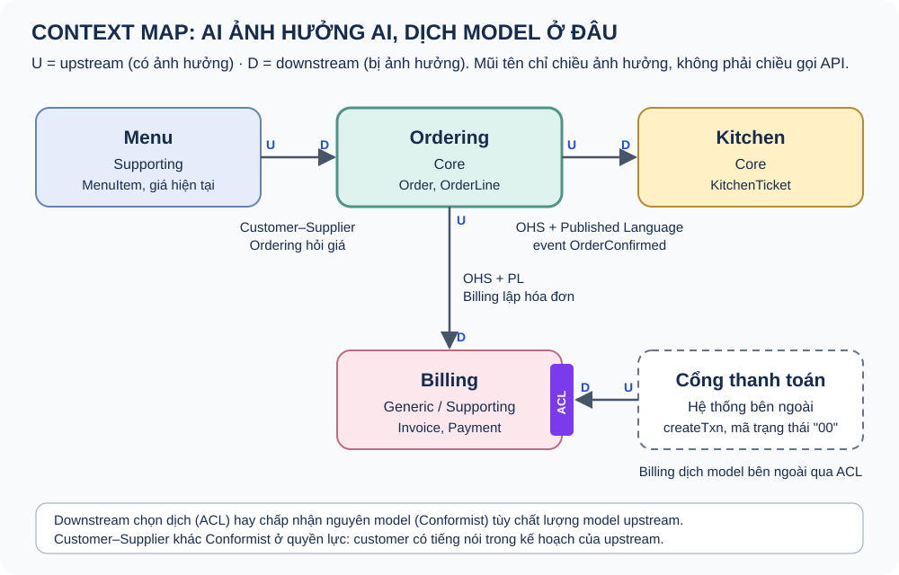
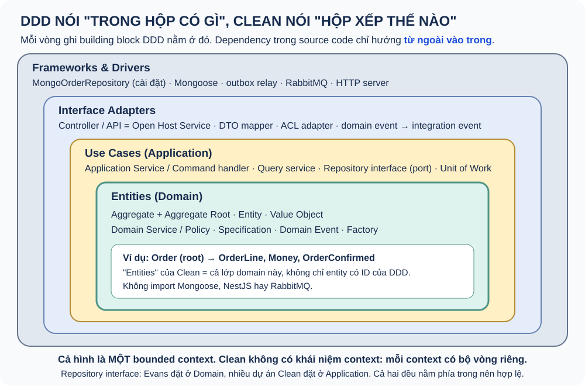

# Domain-Driven Design

Thiết kế phần mềm lấy model nghiệp vụ làm trung tâm, và vị trí của nó so với Clean Architecture.

Ví dụ: nhà hàng (Thực đơn, Đặt món, Bếp, Thanh toán) và w-identity.

Note: Ví dụ nhà hàng là minh họa khái niệm. Phần w-identity chỉ nói những gì code thật có.

---

## DDD là gì

Tập trung vào core domain.

Khám phá model cùng domain expert.

Ubiquitous Language bên trong Bounded Context.

Note: Ba ý trong DDD Reference của Evans. DDD không phải cách chia folder, không bắt buộc microservices, CQRS hay Event Sourcing.

---

## Hai nửa của DDD

Strategic: ngôn ngữ, bounded context, subdomain, context map.

Tactical: entity, value object, aggregate, domain service, domain event, repository.

Note: Strategic đi trước. Ranh giới sai thì tactical đẹp cũng mô hình sai bài toán.

---

## Bounded Context

Ranh giới mà bên trong đó một model và ngôn ngữ có nghĩa nhất quán.

"Món" ở Menu, Ordering, Kitchen, Billing là bốn model khác nhau.

Note: Context là ranh giới model, microservice là ranh giới triển khai. Một context có thể là module trong monolith.

---

## Subdomain

Core: tự xây, đầu tư sâu. Supporting: làm đơn giản. Generic: mua hoặc dùng sẵn.

Note: Subdomain thuộc problem space, bounded context thuộc solution space. Thanh toán là generic với nhà hàng nhưng core với ví điện tử.

---

## Context Map

Note: 9 pattern: Partnership, Shared Kernel, Customer–Supplier, Conformist, ACL, OHS, Published Language, Separate Ways, Big Ball of Mud. Upstream/downstream là chiều ảnh hưởng, không phải chiều gọi API.

---

## Entity và Value Object

Entity: danh tính, vòng đời, bằng nhau khi cùng ID.

Value Object: giá trị, bất biến, tự kiểm tra hợp lệ.

Note: Câu hỏi quyết định: hai đối tượng cùng mọi thuộc tính, nghiệp vụ có coi là một không? Ưu tiên Value Object; tránh Primitive Obsession.

---

## Aggregate

Ranh giới nhất quán bảo vệ invariant. Một root làm cổng vào.

4 quy tắc Vernon: invariant thật · nhỏ · tham chiếu bằng ID · eventual consistency bên ngoài.

Note: Aggregate không phải bảng, cũng không phải interface để hai model gọi nhau. Một transaction sửa một aggregate. Optimistic locking bằng version.

---

## Service, Event, Repository

Domain Service: quy tắc không thuộc entity nào, stateless. Application Service: điều phối, không chứa quy tắc.

Domain Event: thì quá khứ, phát qua outbox. Repository: mỗi aggregate root một cái.

Note: Phát event trước commit là sai; sau commit trong bộ nhớ có thể mất. Domain event khác integration event: integration event là hợp đồng có version.

---

## Chọn kiểu model

Transaction Script cho CRUD. Rich Domain Model cho core phức tạp.

Anemic model: có tên nghiệp vụ nhưng không tự bảo vệ invariant.

Note: Model dùng hàm thuần không anemic nếu quy tắc nằm trong domain và kiểu dữ liệu ngăn trạng thái sai.

---

## DDD và Clean Architecture

DDD: trong hộp có gì. Clean: hộp được xếp thế nào, ai được chạm vào.

Note: Aggregate, VO, domain event ở vòng Entities. Application service ở Use Cases. Repository interface là port của vòng trong. ACL là adapter. Bounded context không có vòng tương ứng: mỗi context là một ứng dụng Clean riêng.

---

## Ba điểm hay nhầm

"Entities" của Clean là cả lớp domain, không chỉ entity có ID.

Layered của Evans cho Domain phụ thuộc Infrastructure; Clean đảo chiều.

Use case của Clean chứa "application-specific rules"; application service của DDD chỉ điều phối.

Note: DDD cần Clean để model thuần. Clean cần DDD để biết quy tắc vòng trong trông thế nào. Bốn tổ hợp có/không đều có chỗ dùng.

---

## DDD không bắt buộc

CQRS · Event Sourcing · Microservices.

Note: Ba quyết định độc lập. Event Sourcing gần như luôn đi kèm CQRS. Không tách microservice theo aggregate; ứng viên tự nhiên là bounded context.

---

## DDD ở w-identity

Clean đầy đủ, DDD nhẹ: authentication generic (Keycloak), RBAC supporting.

UserRole tham chiếu Role bằng tên: sửa permission không phải sửa user.

Note: Điểm yếu đã biết: "không xóa role đang dùng" kiểm tra kiểu check-then-act nên có race; được giới hạn nhờ fail closed. Không nhận là đã làm DDD đầy đủ.
