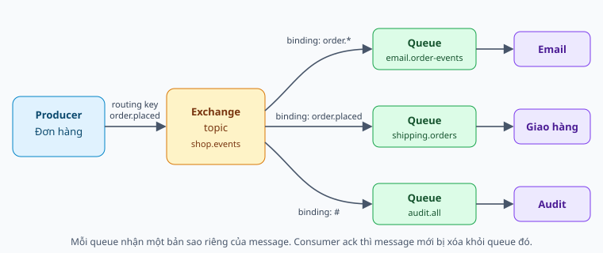

# RabbitMQ từ nền tảng — ôn phỏng vấn

Sổ tay học RabbitMQ từ gốc: vì sao cần message broker, message đi qua broker thế nào, làm sao không mất message, xử lý lỗi ra sao, và vận hành ở mức một backend developer cần biết. Đây là **tài liệu lý thuyết tổng quát**, không mô tả code của dự án. Các đoạn code dùng `amqplib` chỉ để minh họa và chưa được chạy thử. Hành vi broker được mô tả theo dòng RabbitMQ 3.13 và 4.x; khi đi làm thật, hãy đối chiếu tài liệu chính thức của đúng phiên bản.

Học theo thứ tự 0–14, bài sau dựa trên bài trước. Bài 0–7 là phần bắt buộc, bài 8–14 giúp trả lời sâu hơn. Mỗi ngày đọc hai bài rồi tự nói câu trả lời trong 60–90 giây. Trạng thái 📖 là tài liệu lý thuyết, không khẳng định bạn đã học thuộc.

## Bảng tiến độ

| # | Chủ đề | Nhóm | Trạng thái |
|---|---|---|---|
| 0 | RabbitMQ trong 60 giây | Nền tảng | 📖 |
| 1 | Vì sao cần message broker | Nền tảng | 📖 |
| 2 | Kiến trúc: connection, channel, message | Nền tảng | 📖 |
| 3 | Exchange, binding, routing key | Định tuyến | 📖 |
| 4 | Queue và các thuộc tính | Định tuyến | 📖 |
| 5 | Consumer: ack, requeue, prefetch | Tiêu thụ | 📖 |
| 6 | Không mất message: ba chặng | Độ tin cậy | 📖 |
| 7 | Delivery semantics và idempotent | Độ tin cậy | 📖 |
| 8 | Xử lý lỗi: DLX, poison message, retry | Xử lý lỗi | 📖 |
| 9 | Thứ tự message | Xử lý lỗi | 📖 |
| 10 | Messaging patterns | Patterns | 📖 |
| 11 | Vận hành: flow control, kết nối, giám sát | Vận hành | 📖 |
| 12 | High availability: cluster, quorum, stream | Vận hành | 📖 |
| 13 | RabbitMQ và Kafka | So sánh | 📖 |
| 14 | Cách nói khi phỏng vấn | Thực hành | 📖 |

## 0. RabbitMQ trong 60 giây

**RabbitMQ là một message broker**: một server trung gian nhận message từ service gửi (**producer**), giữ chúng trong **queue**, rồi giao cho service nhận (**consumer**). Hai bên không gọi trực tiếp nhau và không cần chạy cùng lúc.

Điểm làm RabbitMQ khác một "hàng đợi đơn giản" là **producer không gửi thẳng vào queue**. Producer gửi vào một **exchange**, kèm một **routing key**. Exchange đối chiếu với các **binding** để quyết định message đi vào queue nào, có thể là một, nhiều, hoặc không queue nào.

Đường đi cơ bản của một message:

1. Producer publish message vào exchange.
2. Exchange định tuyến message vào các queue khớp binding.
3. Queue giữ message cho đến khi có consumer.
4. Broker giao message cho consumer.
5. Consumer xử lý xong rồi gửi **ack**, broker mới xóa message.



### Ví dụ đời thường: bưu điện

| Trong bưu điện | Trong RabbitMQ |
|---|---|
| Người gửi thư | Producer |
| Phòng phân loại | Exchange |
| Địa chỉ ghi trên bì thư | Routing key |
| Quy tắc phân loại ("thư quận 1 vào ngăn A") | Binding |
| Ngăn chứa thư | Queue |
| Bưu tá đi phát thư | Consumer |
| Chữ ký người nhận | Ack |

Người gửi không cần biết bưu tá nào sẽ phát thư, và người nhận vắng nhà thì thư vẫn nằm trong ngăn.

### Ví dụ xuyên suốt: cửa hàng online

Khi khách đặt đơn, service Đơn hàng phát event có routing key `order.placed`. Ba service cần biết: Email gửi mail xác nhận, Giao hàng tạo phiếu giao, Audit ghi nhật ký. Ví dụ này dùng lại ở các bài sau.

**Bẫy phỏng vấn:** Nói "producer gửi message vào queue". Trong mô hình AMQP 0-9-1, producer luôn publish vào exchange. Khi trông như gửi thẳng vào queue, thực ra message đang đi qua default exchange (bài 3).

**Tự trả lời:** giải thích RabbitMQ cho người chưa biết gì trong ba câu, có nhắc đến exchange và ack.

## 1. Vì sao cần message broker

Khi service A gọi HTTP sang service B, A phải chờ B trả lời. Cách này đơn giản nhưng có ba điểm yếu:

- **Ràng buộc thời gian:** B chết hoặc chậm thì A cũng lỗi hoặc chậm theo.
- **Ràng buộc địa chỉ:** A phải biết B là ai. Thêm service C cũng cần biết sự kiện đó thì phải sửa code A.
- **Không chịu được tải đột biến:** bao nhiêu request vào A thì bấy nhiêu đổ sang B.

Broker đổi ba điểm đó thành ba lợi ích:

| Lợi ích | Ý nghĩa | Ví dụ cửa hàng |
|---|---|---|
| Temporal decoupling | Consumer không cần đang chạy lúc message được gửi | Service Email bảo trì 10 phút, mail gửi chậm chứ không mất |
| Decoupling về địa chỉ | Producer không cần biết ai nhận | Thêm service Tích điểm mà không sửa service Đơn hàng |
| Load leveling | Queue hấp thụ đột biến, consumer xử lý theo sức của nó | Flash sale 10.000 đơn một phút, Email vẫn gửi đều |

### Cái giá phải trả

- **Thêm một hệ thống phải vận hành**, và nó có thể trở thành điểm chết chung.
- **Eventual consistency:** lúc đơn đã tạo, mail có thể chưa gửi.
- **Message có thể trùng hoặc đến sai thứ tự**, nên consumer phải được thiết kế cho điều đó (bài 7, bài 9).
- **Khó debug hơn:** một luồng nghiệp vụ trải qua nhiều process, cần correlation id và tracing.

### Khi nào dùng, khi nào không

Dùng khi việc có thể làm sau, tốn thời gian, hoặc có nhiều bên quan tâm: gửi mail, xử lý ảnh, đồng bộ dữ liệu. Không dùng khi caller **cần kết quả ngay để đi tiếp**, như kiểm tra số dư trước khi cho thanh toán; lúc đó gọi đồng bộ đơn giản và đúng hơn.

### Message queue và event log

Có hai họ công cụ thường bị gộp làm một:

- **Message queue** (RabbitMQ): message được giao rồi xóa. Queue là chỗ chứa việc cần làm.
- **Event log** (Kafka, RabbitMQ Stream): message được ghi nối đuôi và giữ lại theo thời gian. Consumer tự nhớ vị trí và đọc lại được.

Bài 13 so sánh chi tiết.

**Bẫy phỏng vấn:** Nói dùng queue "để hệ thống nhanh hơn". Tổng thời gian xử lý thường không giảm. Thứ được cải thiện là thời gian phản hồi của caller, khả năng chịu lỗi và khả năng chịu tải đột biến.

**Tự trả lời:** cho một luồng "đăng ký tài khoản", phần nào nên đồng bộ, phần nào nên đưa qua queue, vì sao?

## 2. Kiến trúc: connection, channel, message

### Giao thức AMQP 0-9-1

RabbitMQ được xây quanh **AMQP 0-9-1**, giao thức định nghĩa cả cách truyền dữ liệu lẫn mô hình exchange, queue, binding. RabbitMQ cũng hỗ trợ AMQP 1.0, MQTT và STOMP, nhưng phỏng vấn gần như luôn dựa trên mô hình 0-9-1. Cổng mặc định là `5672`, TLS là `5671`.

Một điểm đáng chú ý: trong AMQP 0-9-1, **ứng dụng tự khai báo** exchange, queue và binding qua giao thức. Topology không nhất thiết do quản trị viên tạo trước.

### Connection và channel

- **Connection** là một kết nối TCP dài hạn tới broker. Mở connection tốn kém vì phải bắt tay TCP, TLS và xác thực.
- **Channel** là kênh logic chạy bên trong connection, nhẹ hơn nhiều. Mọi thao tác như publish, consume, ack đều chạy trên channel.

Quy tắc thực tế: mỗi process giữ **một hoặc vài connection dùng lâu dài**, và dùng nhiều channel bên trong. Mở connection mới cho từng message là lỗi kinh điển.

Lỗi ở mức channel, ví dụ khai báo queue sai tham số, sẽ **đóng channel đó** mà không ảnh hưởng channel khác. Message đang chưa ack trên channel bị đóng sẽ quay lại queue.

Nên **tách connection cho publish và consume**. Khi broker chặn publisher vì thiếu tài nguyên (bài 11), connection đang publish bị chặn; nếu dùng chung, consumer trên connection đó cũng bị ảnh hưởng, đúng lúc cần nó xả bớt queue.

### Cấu trúc một message

| Phần | Nội dung |
|---|---|
| Routing key | Dùng để exchange định tuyến |
| Properties | Metadata chuẩn của AMQP |
| Headers | Metadata tự do dạng key-value, nằm trong properties |
| Body | Mảng byte. Broker không đọc và không quan tâm định dạng |

Các property nên biết:

| Property | Dùng để |
|---|---|
| `delivery_mode` | `2` là persistent, ghi xuống đĩa (bài 6) |
| `content_type` | Định dạng body, ví dụ `application/json` |
| `message_id` | ID duy nhất, dùng để chống trùng (bài 7) |
| `correlation_id` | Ghép reply với request (bài 10) |
| `reply_to` | Queue nhận phản hồi (bài 10) |
| `expiration` | TTL của riêng message này (bài 8) |
| `timestamp` | Thời điểm tạo |

### Vhost, user, permission

**Vhost** là một không gian cô lập trong cùng broker, có exchange, queue và quyền riêng. Có thể hình dung như database trong một server SQL. **User** được cấp ba quyền theo từng vhost: `configure` (tạo, xóa tài nguyên), `write` (publish) và `read` (consume).

**Bẫy phỏng vấn:** Coi channel là "connection nhẹ" có thể dùng thoải mái giữa nhiều luồng. Nhiều thư viện client không an toàn khi nhiều thread dùng chung một channel. Mô hình phổ biến là mỗi thread một channel, dùng chung connection.

**Tự trả lời:** vì sao RabbitMQ cần channel mà không chỉ dùng nhiều connection?

## 3. Exchange, binding, routing key

**Binding** là quy tắc nối exchange với queue. **Routing key** là nhãn producer gắn lên message. Loại exchange quyết định cách so khớp hai thứ đó.

### Bốn loại exchange

| Loại | Cách khớp | Dùng khi |
|---|---|---|
| Direct | Routing key **bằng đúng** binding key | Phân loại theo giá trị cố định, ví dụ log theo `error`, `info` |
| Fanout | Bỏ qua routing key, gửi **mọi** queue đã bind | Broadcast cho tất cả |
| Topic | Khớp theo **wildcard** trên các từ cách nhau bởi dấu chấm | Event domain, linh hoạt nhất |
| Headers | Khớp theo **headers**, dùng `x-match` là `all` hoặc `any` | Điều kiện nhiều thuộc tính, ít gặp |

### Wildcard của topic exchange

- `*` khớp **đúng một** từ.
- `#` khớp **không hoặc nhiều** từ.

| Binding key | `order.placed` | `order.placed.vip` | `order` |
|---|---|---|---|
| `order.*` | Khớp | Không | Không |
| `order.#` | Khớp | Khớp | Khớp |
| `*.placed` | Khớp | Không | Không |
| `#` | Khớp | Khớp | Khớp |

Với ví dụ cửa hàng: Email bind `order.*`, Giao hàng bind `order.placed`, Audit bind `#`. Một event `order.placed` vào cả ba queue, mỗi queue có **bản sao riêng**, nên service này chậm không ảnh hưởng service kia.

```ts
await ch.assertExchange('shop.events', 'topic', { durable: true });
await ch.assertQueue('email.order-events', { durable: true });
await ch.bindQueue('email.order-events', 'shop.events', 'order.*');

ch.publish('shop.events', 'order.placed', Buffer.from(JSON.stringify(event)), {
  persistent: true,
  messageId: event.id,
  contentType: 'application/json',
});
```

### Default exchange

Mỗi broker có sẵn một direct exchange không tên, gọi là **default exchange**. Mọi queue tự động được bind vào nó với binding key chính là **tên queue**. Vì thế `sendToQueue('email', ...)` thực chất là publish vào default exchange với routing key `email`. Tiện, nhưng producer phải biết tên queue của consumer, tức mất đi lợi ích decoupling.

### Message không có đường đi

Message không khớp binding nào sẽ **bị bỏ im lặng**. Có hai cách phát hiện:

- **`mandatory: true`:** broker trả message lại cho producer qua `basic.return`.
- **Alternate exchange:** khai báo một exchange dự phòng để hứng message không route được.

### Quy ước đặt tên

Exchange theo domain (`shop.events`), routing key theo dạng `<thực thể>.<sự kiện>` ở thì quá khứ (`order.placed`), queue theo **người nhận** và mục đích (`email.order-events`). Quy tắc quan trọng: **consumer sở hữu queue và binding của mình**, producer chỉ biết exchange.

**Bẫy phỏng vấn:** Nói exchange "lưu" message. Exchange chỉ định tuyến rồi thôi. Không có queue nào khớp thì message không được lưu ở đâu cả.

**Tự trả lời:** với routing key `order.placed.vip`, binding nào trong `order.*`, `order.#`, `#.vip`, `*.*.vip` sẽ khớp?

## 4. Queue và các thuộc tính

Queue là nơi message thực sự nằm, hoạt động theo FIFO. Một queue được khai báo với các thuộc tính:

| Thuộc tính | Ý nghĩa |
|---|---|
| `durable` | Định nghĩa queue còn lại sau khi broker restart |
| `exclusive` | Chỉ connection khai báo được dùng, và queue bị xóa khi connection đóng |
| `auto-delete` | Bị xóa khi consumer cuối cùng rời đi |
| Arguments | Tính năng mở rộng dạng `x-...`, ví dụ `x-queue-type`, `x-dead-letter-exchange` |

Khai báo là **idempotent**: gọi lại với cùng tham số thì không có gì xảy ra. Khai báo lại với **tham số khác** thì broker trả lỗi `PRECONDITION_FAILED` và đóng channel. Muốn đổi, phải tạo queue mới và chuyển dữ liệu.

### Arguments và policy

Nhiều cấu hình như TTL, DLX, giới hạn độ dài có thể đặt bằng hai cách. **Queue arguments** nằm trong code, cố định từ lúc tạo. **Policy** do broker quản lý theo pattern tên queue và đổi được khi đang chạy, nên linh hoạt hơn cho vận hành. Riêng loại queue thì không đổi được sau khi tạo.

### Queue dùng cho việc gì

| Mẫu queue | Cấu hình | Dùng cho |
|---|---|---|
| Queue công việc, event quan trọng | Durable, tên cố định | Đa số trường hợp |
| Queue tạm cho một instance | Exclusive hoặc auto-delete, tên do broker sinh | Nhận broadcast như làm mới cache |

Queue phình to là triệu chứng cần xử lý: nó tốn tài nguyên và làm message đến muộn. Broker **không phải database**, queue khỏe mạnh là queue gần như rỗng.

**Bẫy phỏng vấn:** Nghĩ `durable: true` nghĩa là message không mất. `durable` chỉ giữ **định nghĩa queue**. Message phải được đánh dấu persistent mới được ghi đĩa (bài 6).

**Tự trả lời:** bạn muốn đổi một queue đang chạy sang có DLX bằng queue argument thì sẽ gặp gì? Có cách nào khác không?

## 5. Consumer: ack, requeue, prefetch

### Push và pull

- **`basic.consume` (push):** consumer đăng ký, broker chủ động giao. Đây là cách nên dùng.
- **`basic.get` (pull):** consumer hỏi từng message. Kém hiệu quả, chỉ hợp cho việc lẻ.

### Trạng thái message

Trong queue, message ở một trong hai trạng thái:

- **Ready:** đang chờ được giao.
- **Unacked:** đã giao cho consumer, chưa có xác nhận.

Khi consumer chết hoặc channel đóng, mọi message unacked của nó **trở về ready** và được giao lại, kèm cờ `redelivered = true`. Đây là cơ chế cốt lõi giúp không mất việc khi consumer crash.

### Auto ack và manual ack

- **Auto ack:** broker coi message xong ngay khi gửi đi. Nhanh, nhưng consumer chết giữa chừng là mất.
- **Manual ack:** consumer tự báo sau khi xử lý xong. Đây là mặc định nên chọn.

| Lệnh | Ý nghĩa |
|---|---|
| `ack` | Xử lý xong, xóa message |
| `nack` với `requeue=true` | Trả lại queue để giao lại |
| `nack` với `requeue=false` | Bỏ, hoặc chuyển sang DLX nếu có (bài 8) |
| `reject` | Như `nack` nhưng từng message một; `nack` là mở rộng của RabbitMQ, hỗ trợ nhiều message |

```ts
await ch.prefetch(10);
await ch.consume('email.order-events', async (msg) => {
  if (!msg) return; // broker hủy consumer
  try {
    await sendEmail(JSON.parse(msg.content.toString()));
    ch.ack(msg); // chỉ ack sau khi việc đã xong
  } catch {
    ch.nack(msg, false, false);
  }
});
```

Hai lỗi kinh điển: **quên ack** làm message nằm unacked mãi và consumer ngừng nhận khi chạm prefetch; **ack hai lần** làm broker đóng channel. Ngoài ra broker có `consumer_timeout` (mặc định 30 phút): giữ message quá lâu mà không ack thì channel bị đóng và message được giao lại.

### Prefetch

**Prefetch** (`basic.qos`) giới hạn số message unacked một consumer được giữ cùng lúc. Không đặt prefetch thì broker đẩy hết sang một consumer, làm consumer đó ngợp và các consumer khác rảnh rỗi.

| Prefetch | Ưu | Nhược | Hợp với |
|---|---|---|---|
| Thấp (1 đến vài) | Phân phối đều, ít việc dở dang khi crash | Throughput thấp | Việc nặng, lâu |
| Cao (vài chục đến vài trăm) | Throughput cao | Một consumer ôm nhiều, phân phối kém đều | Việc nhanh |

Với runtime bất đồng bộ như Node.js, prefetch chính là **mức xử lý đồng thời** của một consumer. Không có con số đúng cho mọi trường hợp, hãy đo.

### Competing consumers

Nhiều consumer cùng đọc **một queue** thì mỗi message chỉ đến **một** consumer, theo kiểu round-robin có xét prefetch. Đây là cách scale ngang.

**Bẫy phỏng vấn:** Nói "muốn nhiều service cùng nhận thì cho chúng cùng consume một queue". Làm vậy chúng sẽ **chia nhau** message. Muốn mỗi service đều nhận, mỗi service cần một queue riêng bind vào exchange.

**Tự trả lời:** consumer xử lý xong, ghi DB thành công, rồi crash trước khi gửi ack. Chuyện gì xảy ra tiếp theo?

## 6. Không mất message: ba chặng

Message có thể mất ở ba chặng, và mỗi chặng cần một cơ chế riêng. Thiếu một chặng thì hai chặng còn lại vô nghĩa.

| Chặng | Rủi ro | Cơ chế |
|---|---|---|
| Producer → broker | Mất mạng, broker chết trước khi nhận | **Publisher confirm** |
| Trong broker | Broker restart | **Durable queue, persistent message**, replicate bằng quorum queue |
| Broker → consumer | Consumer chết giữa chừng | **Manual ack** |

### Publisher confirm

Bật chế độ confirm trên channel, broker sẽ gửi `ack` cho từng message (hoặc gộp nhiều message) khi đã nhận trách nhiệm với nó. Với message persistent vào durable queue, confirm đến sau khi message đã được ghi đĩa; với quorum queue là sau khi đa số node đã có.

```ts
const ch = await conn.createConfirmChannel();
ch.publish('shop.events', 'order.placed', body, { persistent: true });
await ch.waitForConfirms(); // lỗi nếu broker nack
```

Publish rồi chờ từng message là chậm nhất. Cách tốt hơn là **gửi theo batch hoặc xử lý confirm bất đồng bộ**.

AMQP cũng có **transaction** (`tx.select`), nhưng nó đồng bộ và chậm hơn rất nhiều, nên confirm là lựa chọn gần như mặc định. Lưu ý transaction của AMQP không liên quan gì đến transaction của database.

### Durable và persistent

Cần **cả hai**. Queue không durable thì biến mất khi restart, kéo theo message. Message không persistent thì không sống sót dù queue durable.

### Vẫn còn khe hở

- Confirm chỉ nói broker đã nhận, **không nói message đã vào queue nào**. Message không route được vẫn được confirm, nên phải dùng thêm `mandatory` hoặc alternate exchange.
- Broker chạy một node mà hỏng đĩa thì vẫn mất. Cần quorum queue trên cụm (bài 12).
- Producer có thể **commit DB thành công rồi chết** trước khi publish. Đây là bài toán dual-write, giải bằng Outbox (bài 7).

### Khi không nhận được confirm

Mất kết nối giữa lúc chờ confirm thì producer **không biết** broker đã nhận hay chưa. Cách an toàn là gửi lại, và chấp nhận có thể trùng. Đây chính là nguồn gốc của at-least-once.

**Bẫy phỏng vấn:** Trả lời "bật durable là không mất message". Câu trả lời đủ phải đi qua cả ba chặng, rồi nêu thêm khe hở unroutable và dual-write.

**Tự trả lời:** vẽ đường đi một message và chỉ ra mỗi điểm có thể mất, cùng cơ chế che điểm đó.

## 7. Delivery semantics và idempotent

### Ba mức đảm bảo

| Mức | Ý nghĩa | Cách đạt | Rủi ro |
|---|---|---|---|
| At-most-once | Tối đa một lần | Auto ack, không confirm | Có thể mất |
| At-least-once | Ít nhất một lần | Confirm và manual ack | Có thể trùng |
| Exactly-once | Đúng một lần | Không đạt được ở mức delivery | — |

Trong hệ phân tán, bên gửi không thể phân biệt "bên kia chưa nhận" với "bên kia đã nhận nhưng phản hồi bị mất". Vì thế chỉ có hai lựa chọn: gửi lại và chấp nhận trùng, hoặc không gửi lại và chấp nhận mất.

Điều đạt được trong thực tế là **effectively-once processing = at-least-once delivery + consumer idempotent**.

### Idempotent consumer

Xử lý một message hai lần cho kết quả như xử lý một lần. Các cách làm:

| Cách | Ví dụ | Lưu ý |
|---|---|---|
| Thao tác tự nhiên idempotent | `SET status = 'paid'`, upsert theo khóa | Đơn giản nhất, ưu tiên nếu làm được |
| Bảng dedupe (Inbox) | Lưu `message_id` với unique index | Phải ghi **cùng transaction** với hiệu ứng nghiệp vụ |
| So version | Bỏ qua nếu version trong message cũ hơn | Đồng thời giải quyết sai thứ tự |
| Khóa idempotency ở bên thứ ba | Truyền idempotency key khi gọi cổng thanh toán | Khi hiệu ứng nằm ngoài DB của mình |

Message nên mang một `message_id` do **producer** sinh và không đổi khi gửi lại.

### Dual-write và Outbox

Service vừa ghi DB vừa publish là ghi vào hai hệ thống không có transaction chung. Process chết giữa hai việc thì mất event hoặc sinh event cho việc chưa xảy ra.

**Transactional Outbox** ghi event vào bảng `outbox` trong **cùng transaction** với dữ liệu, rồi một relay đọc bảng đó và publish có confirm. Relay có thể gửi trùng, nên consumer vẫn phải idempotent. Chi tiết xem sổ tay Transactional Outbox.

**Bẫy phỏng vấn:** Nói "RabbitMQ đảm bảo exactly-once". RabbitMQ cho at-least-once khi cấu hình đúng. Câu trả lời đúng là chuyển trọng tâm sang idempotent ở consumer.

**Tự trả lời:** service Tích điểm cộng 100 điểm khi nhận `order.placed`. Message bị giao lại thì làm sao không cộng hai lần?

## 8. Xử lý lỗi: DLX, poison message, retry

### Ba loại lỗi cần phân biệt

| Loại | Ví dụ | Nên làm |
|---|---|---|
| Tạm thời | DB chập chờn, API timeout | Retry có backoff |
| Vĩnh viễn | JSON sai, dữ liệu không hợp lệ | Không retry, chuyển DLQ |
| Lỗi code | Bug sau khi deploy | Giữ message, sửa rồi replay |

### Poison message

Một message luôn làm consumer lỗi. Nếu `nack` với `requeue=true`, nó quay về queue và lại lỗi, tạo **vòng lặp vô hạn** tốn CPU, chặn các message khác và làm đầy log. Không bao giờ requeue vô điều kiện.

### Dead letter exchange

Queue có thể khai báo **DLX**: message "chết" sẽ được chuyển sang exchange đó, thường nối tới một **DLQ** để chứa và điều tra.

Message trở thành dead letter khi:

1. Bị `nack` hoặc `reject` với `requeue=false`.
2. Hết TTL.
3. Bị đẩy ra vì queue vượt giới hạn độ dài.
4. Vượt `delivery-limit` của quorum queue.

Broker thêm header `x-death` ghi lại queue gốc, lý do và số lần. DLQ phải được **giám sát và có người xử lý**, nếu không nó chỉ là nơi giấu lỗi.

### TTL và giới hạn độ dài

- `x-message-ttl`: TTL cho mọi message trong queue.
- `expiration`: TTL cho riêng từng message.
- `x-expires`: xóa cả queue nếu không dùng.
- `x-max-length`, `x-max-length-bytes`: giới hạn queue. `x-overflow` quyết định khi đầy thì bỏ message cũ (`drop-head`, mặc định) hay từ chối message mới (`reject-publish`).

### Retry với backoff

RabbitMQ không có sẵn "retry sau 30 giây" cho queue thường. Cách phổ biến là dùng **retry queue có TTL và không có consumer**:

```text
queue chính ──nack──▶ retry exchange ──▶ retry.30s (TTL 30s, không consumer)
     ▲                                          │ hết TTL, dead-letter
     └──────────────────────────────────────────┘
```

Consumer đọc `x-death` để đếm số lần. Quá N lần thì publish sang DLQ cuối cùng (parking lot) rồi ack. Muốn backoff tăng dần thì tạo nhiều queue: `retry.5s`, `retry.30s`, `retry.5m`.

Có thể dùng plugin `rabbitmq_delayed_message_exchange`, nhưng đây là plugin ngoài và có giới hạn về độ bền, độ sẵn sàng; cần đọc kỹ trước khi dùng cho production.

Với quorum queue, `x-delivery-limit` giới hạn số lần giao lại rồi chuyển sang DLX, nhưng requeue vẫn diễn ra ngay, không có độ trễ.

### Replay từ DLQ

Sau khi sửa lỗi, đẩy message từ DLQ về queue chính bằng Shovel hoặc script. Vì đã có khả năng xử lý lặp, consumer phải idempotent.

**Bẫy phỏng vấn:** Dùng per-message TTL khác nhau trong **cùng một** retry queue. Message hết hạn chỉ được xử lý khi lên đầu queue, nên message TTL ngắn nằm sau message TTL dài sẽ bị kẹt. Vì thế mỗi mức delay nên có một queue riêng với TTL cố định.

**Tự trả lời:** thiết kế luồng retry 3 lần (5 giây, 30 giây, 5 phút) rồi vào DLQ. Cần những queue và exchange nào?

## 9. Thứ tự message

RabbitMQ chỉ đảm bảo: message được publish trên **một channel**, qua **một exchange**, vào **một queue** và đi ra qua **một channel** thì giữ thứ tự.

Thứ tự bị phá khi:

- **Nhiều consumer cùng queue:** message 1 và 2 giao cho hai consumer, message 2 có thể xong trước.
- **Prefetch lớn kèm xử lý đồng thời**, ngay trong một consumer.
- **Requeue hoặc retry:** message lỗi quay lại sau các message khác.
- **Nhiều producer hoặc nhiều channel** cùng publish.

### Các cách xử lý khi cần thứ tự

| Cách | Cơ chế | Đánh đổi |
|---|---|---|
| Consumer tự chịu sai thứ tự | So `version` hoặc `occurredAt`, bỏ event cũ | Cách nên nghĩ đến đầu tiên |
| Single active consumer | Chỉ một consumer nhận, các consumer khác dự phòng | Không scale throughput của queue đó |
| Consistent hash exchange | Băm theo `orderId`, cùng đơn luôn vào cùng queue | Thứ tự theo từng key, phải quản lý nhiều queue |
| Prefetch = 1, một consumer | Tuần tự hoàn toàn | Chậm nhất |

Hầu như không ai cần **thứ tự toàn cục**. Thứ cần là thứ tự **theo từng thực thể**: các event của cùng một đơn hàng. Khi đã xác định như vậy, partition theo key giải quyết được và vẫn scale.

**Bẫy phỏng vấn:** Nói "queue là FIFO nên message luôn được xử lý đúng thứ tự". FIFO chỉ nói về thứ tự **giao đi**, không phải thứ tự **xử lý xong**.

**Tự trả lời:** `order.updated` đến trước `order.created`. Consumer nên làm gì? Liệt kê hai cách.

## 10. Messaging patterns

### Năm mẫu cơ bản

| Pattern | Cấu trúc | Ví dụ |
|---|---|---|
| Work queue | Một queue, nhiều consumer chia việc | Xử lý ảnh |
| Publish/subscribe | Fanout, mỗi subscriber một queue | Làm mới cache mọi instance |
| Routing | Direct, chọn theo key | Log theo mức độ |
| Topics | Topic, chọn theo wildcard | Event domain |
| RPC | Request-reply qua hai đường | Hỏi thông tin từ service khác |

### Request-reply

1. Client publish request kèm `reply_to` và một `correlation_id` duy nhất.
2. Server xử lý, publish reply vào queue `reply_to` với cùng `correlation_id`.
3. Client dùng `correlation_id` để ghép reply với request đang chờ, luôn kèm **timeout**.

**Direct Reply-To** (`amq.rabbitmq.reply-to`) cho phép nhận reply mà không cần tạo queue, nhanh và gọn hơn tạo queue tạm cho mỗi client.

RPC qua broker có giá của cả hai phía: caller vẫn phải chờ, lại thêm một chặng. Timeout cũng **không chứng minh** request chưa được xử lý. Nếu cần kết quả ngay, cân nhắc gRPC hoặc HTTP.

### Event và command

| | Command | Event |
|---|---|---|
| Ý nghĩa | "Hãy làm việc này" | "Việc này đã xảy ra" |
| Đặt tên | Mệnh lệnh: `send-email` | Quá khứ: `order.placed` |
| Số người nhận | Thường một | Không hoặc nhiều |
| Ai quyết định | Người gửi biết việc cần làm | Người nhận tự quyết định phản ứng |

### Saga

Khi một nghiệp vụ trải trên nhiều service, không có transaction chung. **Saga** chia thành các bước cục bộ, mỗi bước có **hành động bù trừ** khi bước sau thất bại. Có hai kiểu: **choreography** (các service phản ứng theo event của nhau, không có điều phối viên) và **orchestration** (một thành phần điều phối ra lệnh từng bước).

### Priority queue

Khai báo `x-max-priority` để message ưu tiên cao được giao trước. Dùng tiết chế, ít mức ưu tiên, vì message ưu tiên thấp có thể bị đói.

**Bẫy phỏng vấn:** Coi mọi message đều là event. Khi producer cần một việc cụ thể được làm và biết rõ ai làm, đó là command. Nhầm hai khái niệm này dẫn đến thiết kế ràng buộc ngầm.

**Tự trả lời:** luồng đặt hàng gồm trừ kho, thanh toán, giao hàng. Thanh toán thất bại thì saga bù trừ thế nào?

## 11. Vận hành: flow control, kết nối, giám sát

### Flow control

Khi quá tải, RabbitMQ tự bảo vệ:

- **Credit-based flow control:** làm chậm connection publish nhanh hơn khả năng xử lý.
- **Memory alarm và disk alarm:** vượt ngưỡng thì broker **chặn mọi connection đang publish** trên toàn cụm. Client nhận được thông báo `connection.blocked` nếu đăng ký.

Hậu quả thường gặp: producer treo khi publish. Vì vậy cần timeout và tách connection như bài 2.

### Kết nối bền bỉ

- **Heartbeat** phát hiện connection chết khi mạng không báo lỗi.
- **Auto-reconnect**: phải tái lập cả connection, channel, **topology và consumer**.
- **Graceful shutdown**: ngừng nhận (cancel consumer), đợi xử lý xong và ack, rồi mới đóng connection. Message chưa ack sẽ được giao lại nên vẫn an toàn, nhưng chạy lại là lãng phí.

### Giám sát

| Chỉ số | Ý nghĩa khi bất thường |
|---|---|
| Queue depth (ready) tăng dần | Consumer không theo kịp |
| Unacked cao | Consumer treo, chậm, hoặc quên ack |
| Consumer count = 0 | Consumer chết hoặc chưa deploy |
| Publish rate so với deliver rate | Xu hướng dồn ứ |
| Consumer utilisation thấp | Prefetch quá nhỏ hoặc mạng chậm |
| Độ dài DLQ | Có message đang lỗi |
| Số connection, channel tăng liên tục | Rò rỉ connection |

Công cụ: Management UI (cổng `15672`) để xem nhanh, plugin Prometheus (cổng `15692`) kèm Grafana cho giám sát thật.

### Xử lý queue dồn ứ

1. Xem `publish` và `deliver`: lượng vào tăng hay lượng ra giảm?
2. Xem consumer: còn sống không, unacked có đầy không, có lỗi không?
3. Nếu downstream chậm thì sửa downstream. Thêm consumer khi đó chỉ làm downstream tệ hơn.
4. Nếu consumer đơn thuần thiếu năng lực thì scale consumer, tăng prefetch.
5. Bảo vệ broker bằng `max-length` hoặc TTL nếu message có thể bỏ.

### Bảo mật

Dùng **TLS** (`amqps`), không dùng tài khoản `guest` (mặc định chỉ đăng nhập được từ localhost), cấp quyền tối thiểu theo từng vhost, không log URI có mật khẩu.

**Bẫy phỏng vấn:** Trả lời queue dồn ứ bằng "thêm consumer". Nếu nút thắt là DB, thêm consumer làm DB chết nhanh hơn. Phải xác định nút thắt trước.

**Tự trả lời:** dashboard báo queue tăng đều từ 30 phút trước, consumer vẫn chạy, unacked đạt đúng tổng prefetch. Bạn nghi điều gì?

## 12. High availability: cluster, quorum, stream

### Cluster

Nhiều node gộp thành một broker logic. **Metadata** (user, vhost, exchange, binding, định nghĩa queue) được chia sẻ trên mọi node, còn **nội dung queue** thì không tự động được nhân bản, trừ khi dùng loại queue có replicate. Client kết nối node nào cũng được, nhưng dùng load balancer và kết nối lại khi node chết.

### Các loại queue

| | Classic | Quorum | Stream |
|---|---|---|---|
| Replicate | Không | Có, bằng Raft | Có |
| Đọc message | Xóa khi ack | Xóa khi ack | **Không xóa**, đọc theo offset |
| Đọc lại | Không | Không | Có |
| Hợp với | Việc tạm, không cần HA | **Mặc định cho dữ liệu quan trọng** | Log, nhiều consumer đọc lại, fan-out lớn |

Classic **mirrored queue** là cơ chế HA cũ, đã bị **loại bỏ từ RabbitMQ 4.0**. Khi học tài liệu cũ, đừng dùng nó làm câu trả lời.

### Quorum queue

Mỗi queue có một leader và các follower. Message chỉ được confirm khi **đa số** node đã ghi. Cần `2f+1` node để chịu được `f` node chết: 3 node chịu 1, 5 node chịu 2. Số node chẵn không tăng khả năng chịu lỗi.

Quorum queue đánh đổi: tốn đĩa và bộ nhớ hơn, độ trễ cao hơn classic, và là queue **luôn durable**. Nó có sẵn `x-delivery-limit` để chặn poison message.

### Network partition

Mạng giữa các node đứt tạo ra split-brain. Quorum queue xử lý nhờ nguyên tắc đa số: phía thiểu số ngừng phục vụ queue đó. Với cấu hình cụm, có các chế độ `pause_minority`, `autoheal` và `ignore`; `pause_minority` thường được khuyến nghị.

### Federation và Shovel

Cluster được thiết kế cho mạng LAN ổn định. Khi cần nối qua WAN hoặc nhiều datacenter, dùng **Federation** (chia sẻ exchange hoặc queue giữa các broker) hoặc **Shovel** (chuyển message từ nguồn sang đích, hữu ích cho migration).

**Bẫy phỏng vấn:** Nói "có cluster nghĩa là HA". Cluster chỉ chia sẻ metadata; một classic queue vẫn nằm trên một node, node đó chết thì queue không dùng được.

**Tự trả lời:** cụm 3 node chạy quorum queue. Một node chết thì sao? Hai node chết thì sao?

## 13. RabbitMQ và Kafka

| Tiêu chí | RabbitMQ | Kafka |
|---|---|---|
| Mô hình | Message broker, smart broker | Distributed log, dumb broker |
| Sau khi đọc | Message bị xóa khi ack | Vẫn giữ theo thời gian retention |
| Đọc lại | Không (trừ Stream) | Có, theo offset |
| Định tuyến | Rất linh hoạt qua exchange | Đơn giản, theo topic và partition |
| Theo dõi tiến độ | Broker theo dõi từng message | Consumer lưu offset |
| Giao hàng | Push | Pull |
| Thứ tự | Theo queue, dễ bị phá khi scale | Theo partition, giữ được khi scale |
| Scale consumer | Thêm consumer vào queue | Giới hạn bởi số partition |
| Throughput | Tốt | Rất cao |
| Độ trễ | Rất thấp ở tải vừa | Thấp, tối ưu cho batch |
| Tính năng từng message | TTL, priority, DLX có sẵn | Phải tự xây retry, DLQ |

### Chọn như thế nào

**Chọn RabbitMQ** khi cần định tuyến phức tạp, task queue, xử lý theo từng message, retry và DLQ theo message, request-reply.

**Chọn Kafka** khi cần lưu lại sự kiện, đọc lại, stream processing, nhiều consumer độc lập đọc cùng dữ liệu, hoặc throughput rất lớn.

Khác biệt cốt lõi cần nói được: RabbitMQ là **hàng đợi công việc** có broker lo phân phối, Kafka là **cuốn nhật ký** để consumer tự đọc. Hai công cụ không thay thế hoàn toàn cho nhau, và một hệ thống lớn có thể dùng cả hai.

**Bẫy phỏng vấn:** Chỉ so "Kafka nhanh hơn". Throughput hiếm khi là lý do chính, trả lời nên xoay quanh việc có cần giữ và đọc lại dữ liệu hay không.

**Tự trả lời:** chọn công cụ cho từng việc: gửi mail xác nhận, lưu clickstream để phân tích, đồng bộ dữ liệu sang search index cần rebuild được.

## 14. Cách nói khi phỏng vấn

### Khung trả lời

Định nghĩa → cơ chế → đánh đổi → khi nào không dùng. Nói 60–90 giây rồi dừng để người hỏi đào tiếp.

### Câu "làm sao không mất message" trong 90 giây

> Message có thể mất ở ba chặng. Từ producer đến broker, tôi dùng publisher confirm và xử lý message không route được bằng mandatory hoặc alternate exchange. Trong broker, tôi dùng durable queue, persistent message, và quorum queue trên cụm ba node để chịu được một node chết. Từ broker đến consumer, tôi dùng manual ack và chỉ ack sau khi xử lý xong. Cách này cho at-least-once, nên message có thể trùng và consumer phải idempotent, thường bằng `message_id` với unique index cùng transaction nghiệp vụ. Còn trường hợp ghi DB xong mà chưa kịp publish thì dùng Transactional Outbox.

### Câu "RabbitMQ khác Kafka" trong 60 giây

> RabbitMQ là broker hàng đợi: định tuyến linh hoạt, giao từng message, xóa sau khi ack, broker theo dõi trạng thái từng message. Kafka là log phân tán: message được giữ theo retention, consumer tự quản lý offset và đọc lại được. Tôi chọn RabbitMQ cho task queue và định tuyến theo message, chọn Kafka khi cần lưu sự kiện để replay hoặc stream processing.

### Câu "thiết kế retry" trong 60 giây

> Trước tiên phân loại lỗi. Lỗi vĩnh viễn đi thẳng vào DLQ. Lỗi tạm thời nack sang retry queue có TTL và không có consumer, hết TTL thì dead-letter về queue chính, với nhiều queue cho các mức delay. Đếm số lần qua `x-death`, vượt ngưỡng thì chuyển parking lot và cảnh báo. Consumer phải idempotent vì message chạy lại nhiều lần.

### Những câu nên nói thật

Nếu chưa vận hành RabbitMQ production, hãy nói rõ: "Tôi nắm cơ chế và đã thử ở môi trường local, chưa có kinh nghiệm chạy cụm production." Người phỏng vấn đánh giá cao ranh giới rõ ràng hơn là những con số không có thật.

### Danh sách nhanh trước khi vào phòng

- Producer gửi vào exchange, không gửi vào queue.
- Bốn loại exchange, `*` một từ, `#` không hoặc nhiều từ.
- Ba chặng mất message và ba cơ chế tương ứng.
- At-least-once cộng idempotent.
- DLX, poison message, retry queue có TTL.
- FIFO không có nghĩa là xử lý đúng thứ tự.
- Prefetch là gì và ảnh hưởng thế nào.
- Quorum queue, `2f+1`, mirrored queue đã bị bỏ.
- RabbitMQ khác Kafka ở chỗ giữ và đọc lại dữ liệu.

**Bẫy phỏng vấn:** Liệt kê tính năng mà không nêu đánh đổi. Một câu kiểu "tôi sẽ không dùng queue ở đây vì caller cần kết quả ngay" thường có giá trị hơn năm thuật ngữ.

**Tự trả lời:** nói liền mạch câu "làm sao không mất message" mà không nhìn tài liệu.

## Từ điển nhanh

| Thuật ngữ | Giải thích |
|---|---|
| Broker | Server trung gian nhận, lưu và giao message |
| Producer | Bên gửi message |
| Consumer | Bên nhận và xử lý message |
| Exchange | Thành phần định tuyến message tới queue |
| Queue | Nơi message được lưu chờ xử lý |
| Binding | Quy tắc nối exchange với queue |
| Routing key | Nhãn trên message dùng để định tuyến |
| Default exchange | Direct exchange không tên, routing key là tên queue |
| Connection | Kết nối TCP dài hạn tới broker |
| Channel | Kênh logic nhẹ chạy trong connection |
| Vhost | Không gian cô lập trong broker |
| Ack | Consumer xác nhận đã xử lý xong |
| Nack | Consumer từ chối message, có thể requeue |
| Requeue | Đưa message trở lại queue |
| Prefetch | Số message chưa ack tối đa một consumer được giữ |
| Ready | Message đang chờ được giao |
| Unacked | Message đã giao, chưa được xác nhận |
| Publisher confirm | Broker xác nhận đã nhận message |
| Durable | Định nghĩa queue hoặc exchange còn sau khi restart |
| Persistent | Message được ghi xuống đĩa |
| At-least-once | Message đến ít nhất một lần, có thể trùng |
| Idempotent | Xử lý nhiều lần cho kết quả như một lần |
| DLX | Exchange nhận message đã chết |
| DLQ | Queue chứa message đã chết |
| Poison message | Message luôn làm consumer lỗi |
| TTL | Thời gian sống của message hoặc queue |
| Competing consumers | Nhiều consumer chia nhau một queue |
| Direct Reply-To | Nhận reply RPC mà không cần tạo queue |
| Quorum queue | Queue nhân bản bằng Raft |
| Stream | Queue dạng log, đọc lại được theo offset |
| Outbox | Ghi event cùng transaction DB rồi relay publish |
| Federation | Chia sẻ message giữa các broker qua WAN |
| Shovel | Chuyển message từ nguồn sang đích |
