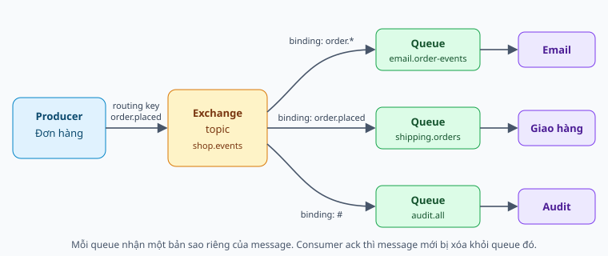

# RabbitMQ từ nền tảng

Message đi qua broker thế nào, và làm sao không mất nó.

Tài liệu lý thuyết tổng quát.

Note: Mục tiêu: nói được mô hình exchange, ba chặng độ tin cậy và các đánh đổi.

---

## Vì sao cần broker

Tách thời gian: bên nhận không cần đang chạy.

Tách địa chỉ: bên gửi không cần biết ai nhận.

San tải: queue hấp thụ đột biến.

Note: Không nói "để nhanh hơn". Cái giá: thêm hệ thống, eventual consistency, trùng và sai thứ tự.

---

## Đường đi của message

Note: Producer luôn publish vào exchange. Exchange không lưu message.

---

## Bốn loại exchange

Direct: khớp chính xác.

Fanout: gửi tất cả.

Topic: wildcard, `*` một từ, `#` không hoặc nhiều từ.

Headers: khớp theo header.

Note: Mỗi service một queue riêng thì mỗi service đều nhận. Cùng một queue thì chia nhau.

---

## Connection và channel

Connection: TCP dài hạn, tốn kém.

Channel: kênh logic nhẹ.

Tách connection publish và consume.

Note: Khi có alarm, connection publish bị chặn, không để consumer bị vạ lây.

---

## Ack và prefetch

Manual ack: chỉ xác nhận sau khi xử lý xong.

Consumer chết: unacked quay lại ready.

Prefetch: số message chưa ack được giữ cùng lúc.

Note: Prefetch thấp phân phối đều, cao thì throughput tốt. Phải đo.

---

## Ba chặng không mất message

Producer → broker: publisher confirm.

Trong broker: durable, persistent, quorum queue.

Broker → consumer: manual ack.

Note: Khe hở còn lại: message không route được vẫn được confirm, và dual-write.

---

## At-least-once

Gửi lại khi không chắc, nên có thể trùng.

Effectively-once = at-least-once + idempotent.

Note: Dedupe theo message_id, ghi cùng transaction với hiệu ứng nghiệp vụ.

---

## Xử lý lỗi

Lỗi tạm thời: retry có backoff.

Lỗi vĩnh viễn: thẳng vào DLQ.

Không requeue vô điều kiện.

Note: Retry queue có TTL, không consumer, hết TTL dead-letter về queue chính. Đếm bằng x-death.

---

## Thứ tự

FIFO là thứ tự giao đi, không phải thứ tự xử lý xong.

Thường chỉ cần thứ tự theo từng thực thể.

Note: Consumer so version, hoặc consistent hash theo key, hoặc single active consumer.

---

## Vận hành

Alarm chặn publisher.

Theo dõi queue depth, unacked, DLQ.

Dồn ứ: tìm nút thắt trước khi thêm consumer.

Note: Nếu nút thắt là DB thì thêm consumer làm DB chết nhanh hơn.

---

## High availability

Cluster chỉ chia sẻ metadata.

Quorum queue: Raft, `2f+1` node.

Mirrored queue đã bị bỏ từ 4.0.

Note: 3 node chịu 1 node chết, 4 node vẫn chỉ chịu 1.

---

## RabbitMQ và Kafka

RabbitMQ: hàng đợi, xóa sau ack, định tuyến linh hoạt.

Kafka: log, giữ theo retention, đọc lại được.

Note: Tiêu chí chính là có cần giữ và đọc lại dữ liệu hay không, không phải tốc độ.
