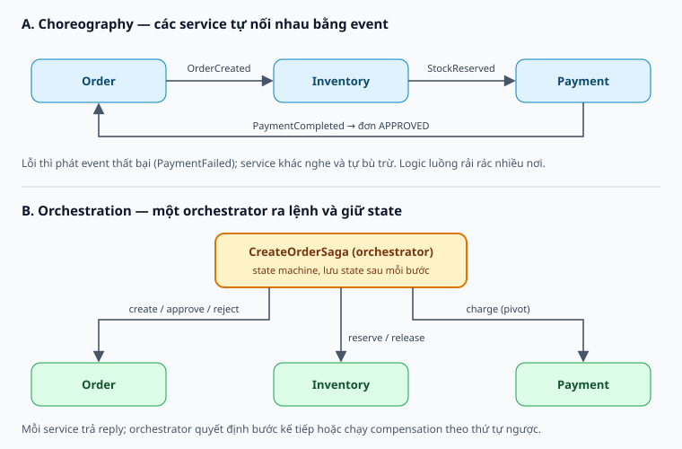
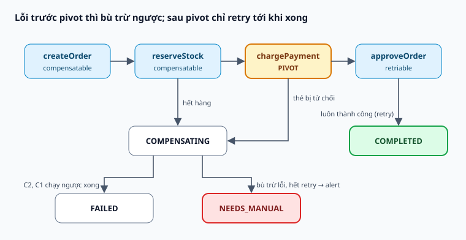

# Saga Pattern — giao dịch xuyên nhiều service

Sổ tay về Saga Pattern: vì sao microservices không dùng được một transaction chung, saga thay thế bằng chuỗi local transaction và compensating transaction ra sao, hai kiểu choreography và orchestration, cách xử lý việc thiếu isolation, và những gì phải tự lo (outbox, idempotency, timeout, saga kẹt). Đây là **tài liệu lý thuyết/thiết kế**: dự án chưa cài saga. Code NestJS là minh họa, chưa chạy thử.

Học theo thứ tự 0–11. Mỗi ngày đọc hai chủ đề, tự nói câu trả lời trong 60–90 giây. Trạng thái 📖 là tài liệu lý thuyết, không khẳng định bạn đã học thuộc.

## Bảng tiến độ

| # | Chủ đề | Nhóm | Trạng thái |
|---|---|---|---|
| 0 | Saga trong 60 giây | Nền tảng | 📖 |
| 1 | Bài toán giao dịch phân tán, vì sao không dùng 2PC | Nền tảng | 📖 |
| 2 | Choreography và Orchestration | Nền tảng | 📖 |
| 3 | Ba loại bước: compensatable, pivot, retriable | Thiết kế | 📖 |
| 4 | Thiết kế compensating transaction | Thiết kế | 📖 |
| 5 | Thiếu isolation: anomaly và countermeasure | Thiết kế | 📖 |
| 6 | Độ tin cậy: outbox, idempotency, retry, timeout | Độ tin cậy | 📖 |
| 7 | State machine và lưu trạng thái saga | Độ tin cậy | 📖 |
| 8 | Code orchestrator bằng NestJS | Thực hành | 📖 |
| 9 | Áp dụng vào dự án: saga tạo project | Thực hành | 📖 |
| 10 | Công cụ và framework | Thực hành | 📖 |
| 11 | Cách nói khi phỏng vấn | Thực hành | 📖 |

## 0. Saga trong 60 giây

**Saga** là một chuỗi **local transaction**, mỗi service commit trong DB của chính nó rồi kích hoạt bước tiếp theo. Nếu một bước thất bại, saga chạy các **compensating transaction** theo thứ tự ngược để hoàn tác nghiệp vụ những bước đã thành công.

- Không có `BEGIN … COMMIT` bao toàn bộ; mỗi bước commit ngay.
- Không "rollback" theo nghĩa DB, mà **bù trừ** bằng một nghiệp vụ mới (hoàn tiền, trả hàng về kho, hủy đơn).
- Kết quả là **eventual consistency**: có một khoảng thời gian hệ thống ở trạng thái trung gian.

### Ví dụ đời thường: đặt tour du lịch

Bạn đặt một chuyến đi gồm vé máy bay, khách sạn và thuê xe, ở ba công ty khác nhau.

1. Đặt vé máy bay → thành công.
2. Đặt khách sạn → thành công.
3. Thuê xe → hết xe.

Không ai "rollback" được vé máy bay của hãng hàng không. Bạn phải **gọi hủy khách sạn**, rồi **gọi hủy vé máy bay** (có thể mất phí). Mỗi cuộc gọi hủy là một compensating transaction; thứ tự hủy ngược với thứ tự đặt.

### Ví dụ xuyên suốt: đặt hàng online

Khách đặt đơn **A1001**. Bốn service tham gia:

| Service | Việc làm | Bù trừ khi saga thất bại |
|---|---|---|
| Order | Tạo đơn `APPROVAL_PENDING` | Chuyển đơn sang `REJECTED` |
| Inventory | Giữ hàng (reserve) | Trả hàng về kho (release) |
| Payment | Trừ tiền thẻ | Không cần: đây là pivot (bài 3) |
| Order | Chuyển đơn sang `APPROVED` | Không cần: retriable |

Ví dụ này dùng lại ở bài 2, 3, 5, 7 và 8.

**Bẫy phỏng vấn:** nói saga "rollback" dữ liệu. Không đúng: dữ liệu đã commit, người khác có thể đã đọc thấy. Saga chỉ **bù trừ** bằng nghiệp vụ.

**Tự trả lời:** giải thích saga cho người chưa biết gì, trong ba câu, dùng ví dụ đặt tour.

## 1. Bài toán giao dịch phân tán, vì sao không dùng 2PC

Trong microservices, mỗi service sở hữu DB riêng (**database-per-service**). Một nghiệp vụ như "đặt hàng" chạm vào Order, Inventory, Payment: ba DB, không có transaction nào bao được cả ba.

```ts
await orderRepo.save(order);              // DB của Order
await inventoryClient.reserve(items);     // DB của Inventory, qua mạng
await paymentClient.charge(card, total);  // DB của Payment, qua mạng — lỗi ở đây thì sao?
```

Lỗi ở dòng 3 thì đơn và hàng đã giữ vẫn còn đó. Phải có cơ chế đưa hệ thống về trạng thái hợp lệ.

### Lựa chọn 1: Two-Phase Commit (2PC / XA)

Một coordinator hỏi mọi participant "chuẩn bị được không?" (prepare), tất cả đồng ý thì ra lệnh commit, một bên từ chối thì ra lệnh rollback.

| Tiêu chí | 2PC | Saga |
|---|---|---|
| Nhất quán | Strong (ACID) | Eventual (ACD, thiếu Isolation) |
| Khóa tài nguyên | Giữ lock suốt hai pha; coordinator chết giữa chừng thì participant treo với lock | Không giữ lock xuyên service |
| Availability | Một participant down thì cả giao dịch không chạy được | Từng bước độc lập, có retry |
| Hỗ trợ | Nhiều broker và NoSQL (RabbitMQ, Kafka, MongoDB) không tham gia XA trong thực tế | Chỉ cần local transaction và messaging |
| Độ phức tạp code | Thấp, framework lo | Cao: phải viết compensation, idempotency |

### Lựa chọn 2: Saga

Đổi một transaction lớn thành nhiều transaction nhỏ, chấp nhận trạng thái trung gian, và thiết kế bù trừ cho từng bước.

Nguồn gốc: Hector Garcia-Molina và Kenneth Salem đặt tên năm 1987 (bài báo *Sagas*, SIGMOD) cho các transaction chạy lâu trong một DB. Chris Richardson (*Microservices Patterns*, 2018) phổ biến nó cho microservices.

**Bẫy phỏng vấn:** nói "2PC không dùng được trong microservices". Chính xác hơn: dùng được về kỹ thuật nếu mọi participant hỗ trợ XA, nhưng đánh đổi availability và coupling, nên hiếm khi là lựa chọn tốt.

**Tự trả lời:** vì sao saga gọi là "ACD"? Chữ nào mất và hệ quả là gì?

## 2. Choreography và Orchestration



**Choreography (vũ đạo):** không ai điều phối. Mỗi service nghe event của service khác, làm phần của mình, rồi phát event tiếp theo.

1. Order tạo đơn `APPROVAL_PENDING`, phát `OrderCreated`.
2. Inventory nghe `OrderCreated`, giữ hàng, phát `StockReserved`.
3. Payment nghe `StockReserved`, trừ tiền, phát `PaymentCompleted`.
4. Order nghe `PaymentCompleted`, chuyển `APPROVED`.

Nếu Payment phát `PaymentFailed`: Inventory nghe và trả hàng, Order nghe và chuyển `REJECTED`.

**Orchestration (nhạc trưởng):** một **orchestrator** (ví dụ `CreateOrderSaga`) gửi command cho từng service, nhận reply, và quyết định bước tiếp theo theo một state machine.

1. Orchestrator gửi `order.create_pending` → reply OK.
2. Gửi `inventory.reserve` → reply OK.
3. Gửi `payment.charge` → reply lỗi.
4. Gửi `inventory.release`, rồi `order.reject`.

| Tiêu chí | Choreography | Orchestration |
|---|---|---|
| Giao tiếp | Event (pub/sub) | Command + reply |
| Coupling | Lỏng, nhưng phụ thuộc ngầm vào event của nhau | Service chỉ biết API của mình; orchestrator biết tất cả |
| Nhìn thấy luồng | Khó: logic rải rác nhiều service | Dễ: đọc một class hoặc state machine |
| Rủi ro | Vòng lặp event, "event spaghetti", khó debug | Orchestrator thành "god service", hút business logic của service khác |
| Điểm lỗi đơn | Không | Orchestrator (giảm bằng state bền và nhiều instance) |
| Thêm bước | Sửa nhiều service | Sửa orchestrator |
| Test | Khó test end-to-end | Test orchestrator như unit test |
| Hợp với | 2–4 bước, ít rẽ nhánh | 4+ bước, rẽ nhánh, timeout, cần audit |

**Quy tắc chọn nhanh:** ít bước, ít rẽ nhánh thì choreography. Nhiều bước, compensation phức tạp, hoặc cần trả lời "saga đang ở đâu?" thì orchestration. Nhiều hệ thống dùng lai: orchestration bên trong một bounded context, choreography giữa các context.

**Bẫy phỏng vấn:** cho rằng orchestration thì service phải gọi đồng bộ. Command và reply hoàn toàn có thể đi qua message broker.

**Tự trả lời:** với luồng đặt hàng 4 bước ở trên, bạn chọn kiểu nào? Nêu hai lý do.

## 3. Ba loại bước: compensatable, pivot, retriable

Mỗi saga có đúng một **pivot transaction**: trước pivot là các bước bù trừ được, sau pivot là các bước chắc chắn thành công nếu retry đủ lâu.

| Loại bước | Định nghĩa | Ví dụ đặt hàng |
|---|---|---|
| Compensatable | Có compensating transaction đi kèm | Tạo đơn `APPROVAL_PENDING`, giữ hàng |
| Pivot | Điểm không quay đầu: thành công thì saga chắc chắn chạy tới cuối; thất bại thì bù trừ ngược | Trừ tiền thẻ |
| Retriable | Sau pivot, idempotent, luôn thành công nếu retry | Chuyển đơn `APPROVED`, gửi email, tạo vận đơn |

**Cách sắp xếp bước:**

- Bước rủi ro nhất và khó hoàn tác nhất (trừ tiền, gọi bên thứ ba) làm pivot. Nó hỏng thì chỉ có ít bước cần bù.
- Việc không thu hồi được (gửi email, SMS, push) đặt **sau** pivot.
- Việc "giảm" (trừ hạn mức, giữ hàng) làm sớm; việc "tăng" làm muộn (xem pessimistic view ở bài 5).

**Bẫy phỏng vấn:** gửi email "đặt hàng thành công" trước khi trừ tiền. Nếu trừ tiền lỗi, email không thu hồi được.

**Tự trả lời:** nếu thêm bước "tạo vận đơn ở hãng giao hàng", bạn đặt nó trước hay sau pivot? Vì sao?

## 4. Thiết kế compensating transaction

Compensation là một nghiệp vụ mới đưa hệ thống về trạng thái hợp lệ, không phải xóa dấu vết.

**Sáu quy tắc:**

1. **Semantic undo, không xóa.** Hoàn tiền là tạo giao dịch `REFUND` mới, không `DELETE` bản ghi `CHARGE`. Hủy đơn là `status = REJECTED`, giữ lịch sử để audit.
2. **Idempotent.** Message có thể đến hai lần; lần hai phải là no-op.
3. **Chịu được việc đến sai thứ tự.** Do timeout và retry, `inventory.release` có thể đến **trước** `inventory.reserve`. Ghi một **tombstone** "saga này đã hủy"; khi `reserve` đến muộn thì từ chối.
4. **Retry tới khi thành công.** Compensation không được phép thất bại vĩnh viễn. Nếu thật sự không thể (tiền đã chuyển ra ngoài), đưa saga vào `NEEDS_MANUAL`, đẩy vào hàng chờ xử lý tay và alert.
5. **Chạy ngược thứ tự.** T1, T2, T3 thành công, T4 lỗi thì chạy C3, C2, C1.
6. **Không phải bước nào cũng hoàn tác được.** Email đã gửi thì gửi email thứ hai "đơn đã bị hủy", hoặc tốt hơn là dời việc gửi ra sau pivot.

### Ví dụ: trả hàng về kho

```ts
// Inventory service — compensation cho inventory.reserve
async release(sagaId: string) {
  const r = await this.reservations.findOne({ sagaId });
  if (!r) {                                   // release đến trước reserve
    await this.tombstones.insert({ sagaId });
    return;
  }
  if (r.status === 'RELEASED') return;        // đã làm rồi: idempotent
  await this.stock.increase(r.items);         // cộng lại, không ghi đè số tồn
  await this.reservations.update(r.id, { status: 'RELEASED' });
}
```

Trong code thật, ba thao tác cuối phải nằm trong cùng một local transaction.

**Bẫy phỏng vấn:** compensation đặt lại giá trị cũ (`stock = 10`). Nếu có saga khác đã thay đổi tồn kho xen giữa, bạn ghi đè mất thay đổi đó. Dùng thao tác cộng/trừ.

**Tự trả lời:** compensation của "trừ tiền thẻ" là gì nếu cổng thanh toán chỉ cho hoàn tiền sau 24 giờ?

## 5. Thiếu isolation: anomaly và countermeasure

Mỗi bước của saga commit ngay, nên saga khác hoặc API đọc **nhìn thấy trạng thái trung gian**. Đây là câu hỏi phân loại ứng viên: nhiều người biết saga, ít người biết xử lý isolation.

### Ba anomaly

| Anomaly | Chuyện gì xảy ra | Ví dụ |
|---|---|---|
| Lost update | Saga A ghi đè thay đổi của saga B mà không đọc nó | `CreateOrder` đang chạy thì `CancelOrder` hủy đơn; bước cuối của `CreateOrder` lại set `APPROVED`, đè mất việc hủy |
| Dirty read | Đọc dữ liệu của saga chưa xong, có thể sẽ bị bù trừ | Saga A đã trừ hạn mức; saga B thấy "hết hạn mức" và từ chối; sau đó A bị bù trừ, B từ chối oan |
| Fuzzy / non-repeatable read | Hai lần đọc trong cùng saga ra hai giá trị khác nhau | Đọc giá sản phẩm lúc tạo đơn và lúc trừ tiền, giữa chừng giá đổi |

### Sáu countermeasure (theo Chris Richardson)

| Countermeasure | Ý tưởng | Khi dùng |
|---|---|---|
| Semantic lock | Bước compensatable gắn cờ `*_PENDING` (`APPROVAL_PENDING`, `CANCEL_PENDING`). Saga khác thấy cờ thì fail-fast, chờ, hoặc retry | Phổ biến nhất, gần như luôn nên có |
| Commutative updates | Thao tác giao hoán: `debit` / `credit` thay vì `set balance = x` | Số dư, tồn kho, điểm thưởng |
| Pessimistic view | Sắp lại bước: việc "giảm" làm sớm (compensatable), việc "tăng" làm muộn (retriable) để dirty read ít hại | Hạn mức, khuyến mãi |
| Reread value | Trước khi ghi, đọc lại bản ghi; đã đổi thì abort hoặc restart saga (optimistic lock, cột `version`) | Chống lost update |
| Version file | Ghi lại các thao tác đã nhận để sắp xếp lại khi chúng đến sai thứ tự | `cancel` đến trước `authorize` |
| By value | Chọn cơ chế theo rủi ro: request rủi ro cao dùng lock phân tán hoặc 2PC, rủi ro thấp dùng saga | Giao dịch giá trị lớn và nhỏ |

### Ví dụ: semantic lock chống lost update

```ts
// Order service
async approve(orderId: string, sagaId: string) {
  const res = await this.orders.updateOne(
    { _id: orderId, status: 'APPROVAL_PENDING', sagaId },   // chỉ khi còn khóa của saga này
    { $set: { status: 'APPROVED' } },
  );
  if (res.matchedCount === 0) throw new OrderStateChanged(orderId); // đã bị hủy bởi saga khác
}
```

`CancelOrder` gặp đơn `APPROVAL_PENDING` thì từ chối ("đơn đang xử lý, thử lại sau") hoặc chờ.

**Bẫy phỏng vấn:** nói "dùng distributed lock là xong". Lock xuyên service đưa bạn quay lại vấn đề của 2PC: treo khi bên giữ lock chết, giảm availability.

**Tự trả lời:** API "xem đơn hàng" nên hiển thị gì khi đơn đang `APPROVAL_PENDING`?

## 6. Độ tin cậy: outbox, idempotency, retry, timeout

Saga chỉ đúng nếu mỗi bước "ghi DB + gửi message" là nguyên tử, và mọi handler đều idempotent. Thiếu một trong hai, saga sẽ kẹt hoặc chạy trùng.

### Dual write → Transactional Outbox

`await repo.save(order); await broker.emit('OrderCreated')` sai: crash giữa hai dòng thì có đơn nhưng không ai biết. Cách đúng là ghi event vào bảng `outbox` trong **cùng local transaction**, rồi một relay publish sau. Chi tiết ở sổ tay **Transactional Outbox** (`#outbox`).

### At-least-once → idempotent consumer

Outbox và broker cho **at-least-once**: message có thể đến hai lần. Mỗi message mang `messageId` (hoặc `sagaId + step`). Consumer lưu id đã xử lý trong cùng transaction với thay đổi nghiệp vụ (unique key); trùng thì bỏ qua. Với API bên thứ ba (cổng thanh toán) dùng header `Idempotency-Key`.

### Retry và backoff

- Lỗi tạm thời (timeout, 503, mất kết nối): retry với exponential backoff và jitter.
- Lỗi nghiệp vụ (hết hàng, thẻ bị từ chối): **không retry**, chuyển sang bù trừ.
- Quá N lần: đẩy vào Dead Letter Queue và alert, không chặn cả hàng đợi.

### Timeout

Mỗi bước có deadline. Hết giờ mà chưa có reply thì orchestrator coi là thất bại (hoặc hỏi lại trạng thái theo `sagaId`) rồi bù trừ.

**Quan trọng:** timeout **không** có nghĩa là bên kia chưa làm. Có thể nó đã làm xong nhưng reply bị mất. Vì vậy compensation phải chịu được việc action đã xảy ra hoặc đến muộn (tombstone, bài 4).

### Observability

- Truyền `sagaId` / `correlationId` trong mọi message và log.
- Distributed tracing (OpenTelemetry) để xem một saga đi qua các service.
- Dashboard: số saga theo trạng thái, saga kẹt quá X phút, tỉ lệ bù trừ.

**Bẫy phỏng vấn:** nói broker đảm bảo "exactly-once" nên không cần idempotent. Exactly-once hiệu dụng chỉ đạt được khi consumer idempotent.

**Tự trả lời:** orchestrator gửi `payment.charge`, chờ 5 giây không có reply. Bạn làm gì tiếp, và vì sao không bù trừ ngay?

## 7. State machine và lưu trạng thái saga



Orchestrator là một state machine. Trạng thái phải được **lưu bền sau mỗi bước**, không giữ trong RAM.

```text
saga_instance
  id            uuid
  type          'CreateOrder'
  state         STARTED | COMPENSATING | COMPLETED | FAILED | NEEDS_MANUAL
  current_step  'reserveStock'
  payload       { orderId, items, total, ... }
  version       số nguyên, dùng cho optimistic lock
  updated_at    thời điểm
```

**Orchestrator chết giữa chừng:** khi khởi động lại, hoặc một job **sweeper** chạy định kỳ, quét các saga chưa kết thúc và `updated_at` quá cũ, rồi chạy tiếp từ `current_step`. Vì bước có thể chạy lại, participant phải idempotent.

**Nhiều instance orchestrator:** dùng optimistic lock trên cột `version` để hai instance không cùng xử lý một saga.

**Các trạng thái cuối:**

- `COMPLETED`: mọi bước thành công.
- `FAILED`: đã bù trừ xong, hệ thống nhất quán, nghiệp vụ không thành.
- `NEEDS_MANUAL`: bù trừ thất bại sau khi hết retry; cần người xử lý.

**Bẫy phỏng vấn:** coi `FAILED` là lỗi hệ thống. Không phải: saga thất bại và bù trừ sạch là kết quả hợp lệ (khách hết tiền, kho hết hàng).

**Tự trả lời:** saga kẹt ở `COMPENSATING` 30 phút. Bạn điều tra từ đâu?

## 8. Code orchestrator bằng NestJS

Ví dụ dùng transport TCP của NestJS như các service trong dự án (gateway gọi service bằng `ClientProxy.send()` với `MessagePattern`). Code minh họa, chưa chạy thử.

### Định nghĩa bước

```ts
export interface SagaStep<C> {
  name: string;
  action: (ctx: C) => Promise<Partial<C>>;   // trả dữ liệu bổ sung vào context
  compensate?: (ctx: C) => Promise<void>;     // phải idempotent
}
```

### Orchestrator

```ts
@Injectable()
export class CreateOrderSaga {
  constructor(
    @Inject('ORDER') private order: ClientProxy,
    @Inject('INVENTORY') private inventory: ClientProxy,
    @Inject('PAYMENT') private payment: ClientProxy,
    private sagas: SagaInstanceRepository,
  ) {}

  private call<T>(client: ClientProxy, pattern: string, data: unknown) {
    return firstValueFrom(client.send<T>(pattern, data).pipe(timeout(5000)));
  }

  private steps: SagaStep<OrderCtx>[] = [
    { name: 'createOrder',                                   // compensatable
      action: async (c) => ({ orderId: (await this.call<{ id: string }>(this.order, 'order.create_pending', c)).id }),
      compensate: async (c) => { await this.call(this.order, 'order.reject', { orderId: c.orderId, sagaId: c.sagaId }); } },
    { name: 'reserveStock',                                  // compensatable
      action: async (c) => { await this.call(this.inventory, 'inventory.reserve', c); return {}; },
      compensate: async (c) => { await this.call(this.inventory, 'inventory.release', { sagaId: c.sagaId }); } },
    { name: 'chargePayment',                                 // PIVOT
      action: async (c) => { await this.call(this.payment, 'payment.charge', c); return {}; } },
    { name: 'approveOrder',                                  // retriable
      action: async (c) => { await retry(() => this.call(this.order, 'order.approve', c)); return {}; } },
  ];

  async run(input: OrderCtx) {
    const saga = await this.sagas.create({ type: 'CreateOrder', state: 'STARTED', ctx: input });
    const done: SagaStep<OrderCtx>[] = [];
    try {
      for (const step of this.steps) {
        Object.assign(saga.ctx, await step.action(saga.ctx));
        done.push(step);
        await this.sagas.save({ ...saga, currentStep: step.name });   // lưu sau MỖI bước
      }
      await this.sagas.save({ ...saga, state: 'COMPLETED' });
    } catch (err) {
      await this.sagas.save({ ...saga, state: 'COMPENSATING', error: String(err) });
      for (const step of done.reverse()) {
        try {
          await retry(() => step.compensate?.(saga.ctx) ?? Promise.resolve());
        } catch {
          await this.sagas.save({ ...saga, state: 'NEEDS_MANUAL' });   // alert người vận hành
          return;
        }
      }
      await this.sagas.save({ ...saga, state: 'FAILED' });
    }
  }
}
```

Đơn giản hóa so với bản production: chưa phân biệt lỗi nghiệp vụ và lỗi tạm thời ở bước pivot, chưa có sweeper, chưa dùng `version`.

### Participant: handler idempotent

```ts
@MessagePattern('inventory.reserve')
async reserve(@Payload() d: { sagaId: string; items: Item[] }) {
  return this.db.transaction(async (tx) => {
    if (await tx.reservations.exists({ sagaId: d.sagaId })) return { ok: true };      // đã làm
    if (await tx.tombstones.exists({ sagaId: d.sagaId })) throw new RpcException('SAGA_CANCELLED');
    await tx.stock.decrease(d.items);           // stock = stock - qty WHERE stock >= qty
    await tx.reservations.insert({ sagaId: d.sagaId, items: d.items, status: 'RESERVED' });
    return { ok: true };
  });
}
```

### Lưu ý với transport TCP

TCP của NestJS là request/response, **không có hàng đợi bền**: service đích down thì lệnh mất, không có redelivery. Vì vậy:

1. Orchestrator phải tự lưu state và có sweeper chạy tiếp saga dở dang.
2. Timeout không có nghĩa bên kia chưa làm: handler phải idempotent và có tombstone.
3. Khi cần độ bền thật, chuyển command/reply sang RabbitMQ hoặc Kafka kèm outbox, hoặc dùng workflow engine như Temporal (bài 10).

**Tự trả lời:** trong code trên, nếu process chết ngay sau `payment.charge` thành công nhưng trước `sagas.save`, chuyện gì xảy ra khi sweeper chạy lại?

## 9. Áp dụng vào dự án: saga tạo project

Đây là **thiết kế đề xuất**, chưa triển khai. Nó là ví dụ tốt để kể khi phỏng vấn vì có một hệ thống bên ngoài (Keycloak) không thể tham gia transaction của bạn.

**Nghiệp vụ:** người dùng tạo project. Cần dữ liệu project ở `u-project-management`, và group/role tương ứng trên Keycloak qua `w-identity` để phân quyền.

| # | Bước | Service | Loại | Bù trừ |
|---|---|---|---|---|
| 1 | Tạo project `PROVISIONING` | u-project-management | Compensatable | Chuyển `FAILED` |
| 2 | Tạo group và role cho project trên Keycloak | w-identity | Compensatable | Xóa group (idempotent: không tìm thấy thì coi như xong) |
| 3 | Gán owner vào group | w-identity | Pivot | — |
| 4 | Chuyển project sang `ACTIVE`, ghi activity log | u-project-management | Retriable | — |

**Các quyết định cần nói được:**

- **Orchestration**, vì có 4 bước, chạm hệ thống ngoài, và cần biết project đang kẹt ở đâu.
- **Semantic lock:** project `PROVISIONING` không cho thêm thành viên hay tạo task; UI hiển thị "đang khởi tạo".
- **Idempotency với Keycloak:** đặt tên group xác định từ `projectId` (ví dụ `project-<id>`), nên tạo lại thì gặp "đã tồn tại" và coi là thành công.
- **Timeout khi gọi Keycloak:** group có thể đã được tạo dù không nhận được reply; bù trừ bằng "xóa nếu tồn tại".

**Tự trả lời:** kể saga này theo khung STAR trong 90 giây.

## 10. Công cụ và framework

Production thường không tự viết orchestrator từ đầu: workflow engine đã giải sẵn state bền, retry, timer và giao diện theo dõi. Tự viết (bài 8) vẫn nên làm để hiểu bản chất.

| Công cụ | Kiểu | Điểm nổi bật |
|---|---|---|
| Temporal (hậu duệ của Cadence) | Orchestration, viết bằng code | Workflow là code thường, state được ghi lại và replay; retry policy và timer dài ngày có sẵn. Java SDK có class `Saga`; với TypeScript SDK bạn tự gom compensation trong `try/catch` |
| Camunda 8 / Zeebe | Orchestration, BPMN | Vẽ luồng bằng BPMN, có compensation event; hợp quy trình có bước người duyệt |
| AWS Step Functions | Orchestration, managed | State machine định nghĩa bằng JSON (ASL), dùng `Catch` để nhảy sang nhánh bù trừ |
| Azure Durable Functions | Orchestration, viết bằng code | Orchestrator function, tương tự Temporal trên Azure |
| Axon Framework (Java) | Cả hai | `@Saga`, `@SagaEventHandler`, đi cùng CQRS và Event Sourcing |
| MassTransit (.NET) | Cả hai | Saga state machine, state lưu DB |
| Eventuate Tram Sagas (Java) | Orchestration | Framework của Chris Richardson, có outbox sẵn |
| `@nestjs/cqrs` `@Saga()` | Trong một process | Một RxJS stream map event thành command; **không** có state bền, không phải distributed saga |

**Bẫy phỏng vấn:** nói "dùng `@Saga()` của NestJS CQRS" là đã có distributed saga. Nó là process manager trong bộ nhớ; process chết là mất tiến trình.

**Tự trả lời:** khi nào bạn chọn Temporal thay vì tự viết orchestrator?

## 11. Cách nói khi phỏng vấn

### Khung trả lời 90 giây cho "Saga là gì?"

1. **Vấn đề (15 giây):** microservices dùng database-per-service nên một nghiệp vụ chạm nhiều DB không có transaction chung; 2PC giữ lock và giảm availability.
2. **Định nghĩa (15 giây):** saga là chuỗi local transaction; bước nào lỗi thì chạy compensating transaction ngược lại. Kết quả là eventual consistency, mất chữ I trong ACID.
3. **Hai kiểu (20 giây):** choreography bằng event cho luồng ngắn; orchestration bằng state machine cho luồng dài, dễ theo dõi.
4. **Phần khó (30 giây):** outbox chống dual write, consumer idempotent vì at-least-once, semantic lock chống lost update, timeout không có nghĩa bên kia chưa làm.
5. **Ví dụ (10 giây):** đặt hàng, hoặc saga tạo project kèm Keycloak ở bài 9.

### Lỗi thường gặp khi thiết kế

| Lỗi | Hậu quả | Sửa |
|---|---|---|
| `save()` rồi `emit()` riêng | Mất event khi crash, saga kẹt | Outbox |
| Handler không idempotent | Trừ tiền hoặc trừ kho hai lần | Lưu `messageId` / `sagaId` với unique key |
| Compensation bằng `DELETE` | Mất audit, sai khi có thao tác xen giữa | Trạng thái `REJECTED`, giao dịch bù |
| Retry cả lỗi nghiệp vụ | Retry mãi "hết hàng" | Phân biệt lỗi tạm thời và lỗi nghiệp vụ |
| Không có trạng thái `*_PENDING` | Saga khác đọc hoặc ghi đè dữ liệu trung gian | Semantic lock |
| Orchestrator giữ state trong RAM | Restart là mất saga | Lưu `saga_instance` sau mỗi bước |
| Gửi email trước pivot | Không thu hồi được | Đặt sau pivot |
| Choreography cho luồng 8 bước | Event spaghetti, không ai biết luồng | Orchestration |

### Câu hỏi nên hỏi lại người phỏng vấn

- "Hệ thống của anh/chị dùng choreography hay orchestration, và vì sao?"
- "Saga kẹt hoặc `NEEDS_MANUAL` được xử lý thế nào trong vận hành?"

**Tài liệu nên đọc:** Chris Richardson, *Microservices Patterns* (2018), chương 4, và [microservices.io/patterns/data/saga](https://microservices.io/patterns/data/saga.html); Garcia-Molina và Salem, *Sagas* (SIGMOD 1987); Microsoft Azure Architecture Center, *Saga distributed transactions pattern*.

## Từ điển nhanh

| Thuật ngữ | Nghĩa |
|---|---|
| Saga | Chuỗi local transaction, lỗi thì bù trừ ngược lại |
| Local transaction | Transaction ACID trong DB của một service |
| Compensating transaction | Nghiệp vụ mới hoàn tác nghiệp vụ một bước đã commit |
| Choreography | Saga không có điều phối; service phản ứng event của nhau |
| Orchestration | Saga có orchestrator gửi command và quyết định bước tiếp |
| Orchestrator | Thành phần giữ state machine của saga |
| Pivot transaction | Bước không quay đầu; thành công thì saga chắc chắn đi tới cuối |
| Retriable transaction | Bước sau pivot, idempotent, retry tới khi thành công |
| 2PC | Two-Phase Commit: prepare rồi commit, giữ lock xuyên hệ thống |
| Eventual consistency | Dữ liệu nhất quán sau một khoảng thời gian, không tức thì |
| Semantic lock | Cờ trạng thái `*_PENDING` báo bản ghi đang thuộc một saga dở dang |
| Commutative update | Thao tác giao hoán (cộng/trừ) thay vì ghi đè giá trị |
| Tombstone | Dấu "saga này đã hủy" để từ chối action đến muộn |
| Transactional outbox | Ghi event cùng transaction với dữ liệu, relay publish sau |
| Idempotent consumer | Consumer xử lý cùng message nhiều lần vẫn cho một kết quả |
| Sweeper | Job quét saga kẹt để chạy tiếp hoặc alert |
| Process manager | Tên gọi khác của orchestrator trong DDD/EIP |
