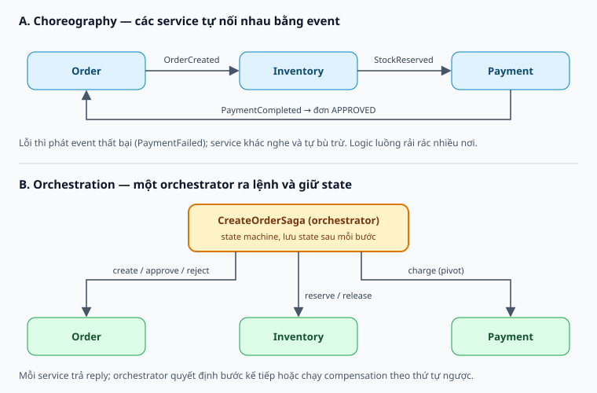
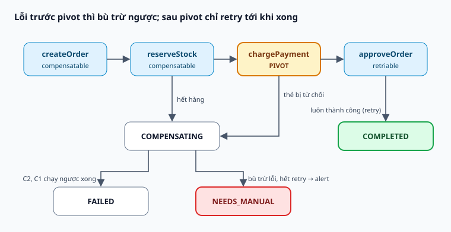

# Saga Pattern

Giao dịch xuyên nhiều service mà không cần 2PC.

Tài liệu lý thuyết và thiết kế, chưa triển khai trong dự án.

Note: Nói rõ đây là thiết kế; dự án chưa có saga.

---

## Vấn đề

Database-per-service: một nghiệp vụ chạm nhiều DB, không có transaction chung.

2PC giữ lock và giảm availability.

Note: Ví dụ đặt hàng chạm Order, Inventory, Payment. Payment lỗi thì đơn và hàng đã giữ vẫn còn.

---

## Ý tưởng

Chuỗi local transaction. Lỗi thì chạy compensating transaction ngược lại.

Eventual consistency, mất chữ I trong ACID.

Note: Không rollback mà bù trừ bằng nghiệp vụ: hoàn tiền, trả hàng, hủy đơn.

---

## Hai kiểu

Note: Choreography cho luồng ngắn. Orchestration cho luồng dài, nhiều nhánh, cần biết saga đang ở đâu.

---

## Pivot

Compensatable → Pivot → Retriable.

Note: Bước rủi ro nhất làm pivot. Email đặt sau pivot vì không thu hồi được.

---

## State machine

Note: Lưu state sau mỗi bước. Sweeper chạy tiếp saga kẹt. NEEDS_MANUAL khi bù trừ hết retry.

---

## Isolation

Lost update, dirty read, fuzzy read.

Semantic lock, commutative update, reread value.

Note: APPROVAL_PENDING là semantic lock. Bước cuối chỉ cập nhật khi cờ còn đúng của saga mình.

---

## Độ tin cậy

Outbox chống dual write. Consumer idempotent vì at-least-once.

Timeout không có nghĩa bên kia chưa làm.

Note: Tombstone để từ chối action đến sau compensation.

---

## Áp dụng: tạo project

Project PROVISIONING → group Keycloak → gán owner → ACTIVE.

Note: Keycloak không tham gia transaction được. Tên group xác định từ projectId để idempotent.
